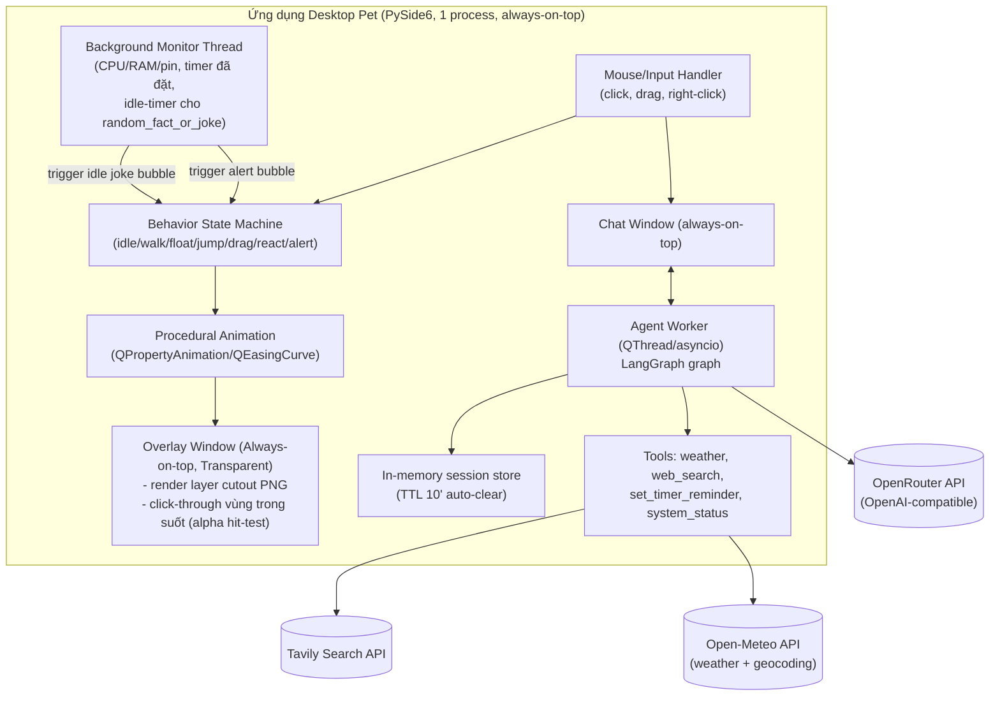

# CONTEXT.md — Calcifer Desktop Pet

> File này lưu toàn bộ bối cảnh dự án để đọc lại và hiểu nhanh mục đích, kiến trúc, quyết định kỹ thuật. Cập nhật file này mỗi khi có quyết định mới hoặc thay đổi thiết kế quan trọng.

## 1. Mục đích dự án

Xây dựng một **desktop pet cá nhân** lấy hình tượng **Calcifer** (fan art phong cách Ghibli, không dùng asset gốc phim) chạy nền trên Windows:

- Sống ở **lớp desktop background** (không nổi lên trên các ứng dụng khác đang mở — dùng kỹ thuật gắn cửa sổ vào WorkerW).
- Tự động di chuyển/animate liên tục theo 3 kiểu: đi dọc mép màn hình, bay lơ lửng tự do, nhảy.
- Tương tác chuột: click → animation phản ứng + random 1 câu thoại; kéo-thả để di chuyển nhân vật.
- Right-click → mở cửa sổ chat (nổi lên trên các app khác để luôn gõ được), chat bằng text (voice để sau).
- Là một **agent thực sự** có khả năng gọi tool (weather, web search, ...) để trả lời câu hỏi, không phải chatbot thuần.
- Dùng cá nhân (không phát hành công khai/thương mại) — cần lưu ý bản quyền nhân vật Ghibli.

## 2. Kiến trúc tổng thể

**Một process Python duy nhất** (không tách service riêng qua network), gồm 2 mảng logic:



### Lý do chọn kiến trúc này
- Overlay (PySide6) và Agent (LangGraph) đều là Python → gộp 1 process, giao tiếp qua Qt signal/slot, tránh phải chạy thêm 1 local server/WebSocket (đơn giản hơn, ít rủi ro bảo mật hơn).
- Agent chạy trong thread/asyncio riêng để không block UI thread khi chờ LLM/tool trả lời.

## 3. Quyết định kỹ thuật đã chốt

| Hạng mục | Quyết định |
|---|---|
| Ngôn ngữ / GUI framework | Python + **PySide6** |
| Hệ điều hành mục tiêu | Windows only, **1 màn hình** (không cần hỗ trợ multi-monitor) |
| Kiểu cửa sổ overlay | **Always-on-top + transparent background thông thường** (Qt.WindowStaysOnTopHint + WA_TranslucentBackground). KHÔNG dùng kỹ thuật WorkerW/gắn desktop layer nữa — pet luôn nổi trên mọi ứng dụng khác |
| Click-through | Vùng trong suốt xung quanh nhân vật phải cho chuột xuyên qua app phía dưới (alpha-based hit-test / QRegion mask), chỉ vùng có pixel thật của nhân vật mới bắt sự kiện chuột |
| LLM provider | **Google Gemini API trực tiếp** (không qua OpenRouter nữa), model **`gemini-2.0-flash`**, dùng `langchain-google-genai` (`ChatGoogleGenerativeAI`), key trong `GEMINI_API_KEY` |
| Agent framework | **LangGraph** (không dùng Google ADK cho project này) |
| System Tray | Icon tray luôn hiện khi app chạy, cho phép **bật/tắt hiển thị pet** (ẩn overlay nhưng agent/monitor vẫn chạy nền), cùng các lệnh quản lý khác (thuật, mở config, thoát) |
| Kiến trúc process | 1 process duy nhất, agent chạy trong thread/asyncio riêng trong app PySide6 |
| Animation | **Nhân vật vẽ hoàn toàn bằng code** (vector QPainter, `src/overlay/character.py` + `src/overlay/fire_field.py`), vẽ lại mỗi frame (mặc định 60fps, chỉnh `character.fps`; kích thước `character.scale` = **0.75** → cửa sổ 150x177 px) — KHÔNG cần file PNG. Phong cách sticker phẳng theo ảnh mẫu fan-art user gửi: 3 lớp đỏ / cam / thân vàng lớn + 1 đường viền nâu đỏ đậm liền mạch, mắt trắng viền đậm con ngươi nhỏ, miệng đỏ + lưỡi hồng, đốm sáng trên thân, **giữ quầng sáng (glow)**, **không thêm viền trắng kiểu sticker** (xem §7). **Hình ngọn lửa = mô phỏng hạt "lưỡi lửa" + metaball** (cần `numpy`): các lưỡi lửa sinh ra trên thân, bay lên, cong theo gió, nhập vào nhau, đứt ra thành mẩu lửa rồi tắt; 3 lớp màu là 3 đường đồng mức của cùng 1 trường mật độ → luôn là đường viền liền, lồng nhau, không lỗ thủng, không có gai cố định. Di chuyển cửa sổ tạo "gió" làm lửa ngả ra sau. Vật lý lò xo (nghiêng/kéo giãn/nảy khi chạm đất/nhún khi đi); mắt chớp (nhắm nhanh, mở chậm), liếc kiểu saccade + rung nhẹ, nhìn theo chuột; 6 biểu cảm (normal/happy/surprised/alert/thinking/talking) chuyển bằng lò xo hơi vượt đích (mắt "bật" khi ngạc nhiên), miệng nói chuyện theo nhiễu có ngắt câu; tàn lửa bay ra từ sau ngọn lửa. **Chuyển động mượt**: vị trí cửa sổ lưu dạng số thực (`exactPos`), phần lẻ dưới 1 pixel được vẽ bù; vòng frame chạy chung đồng hồ animation của Qt với các animation di chuyển nên không bị giật. Click-through dựa vào alpha từng pixel của Windows (không dùng `setMask`). Cách PNG cutout cũ trong [ANIMATION_TUTORIAL.md](./ANIMATION_TUTORIAL.md) không còn dùng |
| Kiểu di chuyển | Cả 3: đi dọc mép màn hình, bay lơ lửng tự do, nhảy — random luân phiên |
| Tương tác click | Trigger animation phản ứng + random 1 câu thoại trong list có sẵn |
| Kéo thả | Cho phép kéo-thả di chuyển nhân vật |
| Chat window | Mở bằng right-click, always-on-top, text-only (v1), voice để sau |
| Lịch sử hội thoại | Không lưu lâu dài — chỉ lưu trong RAM, tự xóa sạch sau **10 phút** không hoạt động (TTL) |
| Tool: weather | **Open-Meteo** (free, không cần API key). Vị trí lấy từ prompt người dùng (LLM trích xuất tên địa điểm → geocode qua Open-Meteo Geocoding API → lấy thời tiết) |
| Tool: web_search | **Tavily** (free tier, cần API key) |
| Tool: set_timer_reminder | Đặt hẹn giờ theo yêu cầu chat, hết giờ → hiện bong bóng nhắc nhở |
| Tool: system_status | Theo dõi CPU/RAM/pin định kỳ (background thread); ngưỡng cảnh báo đã chốt: **pin < 30%**, **CPU > 90%**, **RAM > 90%** → tự động trigger animation cảnh báo + bong bóng thông báo, **giữ nguyên cho tới khi người dùng click vào pet** mới tắt. Cũng có thể được LLM gọi chủ động khi người dùng hỏi (vd "pin còn bao nhiêu") |
| Tool: random_fact_or_joke | Không phải tool do LLM gọi — là hành vi chủ động (ambient): sau một khoảng thời gian idle (không chat), tự động hiện bong bóng với 1 câu random từ list 50 câu (đã soạn sẵn trong `data/facts_jokes.json`) |
| Ngôn ngữ câu thoại tự động | Tất cả các câu hiển thị tự động trên màn hình (fact/joke, phản ứng khi click) đều bằng **tiếng Anh** |
| Autostart | Giai đoạn dev: shortcut trong thư mục Startup Windows chạy bằng `pythonw.exe`; giai đoạn sau: Task Scheduler khi đóng gói .exe |
| Bản quyền | Dùng fan art tự tạo/stylized, không dùng asset gốc phim; chỉ dùng cá nhân |

## 4. Quyết định còn mở (nhỏ, không chặn tiến độ — sẽ chốt nốt khi bắt đầu code)

1. **Cần xác nhận lại**: chuyển hẳn từ OpenRouter sang gọi thẳng Google Gemini API (không qua trung gian) — đúng ý bạn chứ?
2. Cách chuẩn bị layer PNG thực tế cho Calcifer (bạn tự tách theo hướng dẫn trong `ANIMATION_TUTORIAL.md`).
3. Tần suất kiểm tra `system_status` (đề xuất mặc định 45 giây/lần, có thể chỉnh trong `config.yaml`).
4. Khoảng thời gian idle trước khi `random_fact_or_joke` tự kích hoạt (đề xuất mặc định ngẫu nhiên 15-30 phút, có thể chỉnh trong `config.yaml`).

Đã giải quyết: ngưỡng cảnh báo `system_status` (pin < 30%, CPU/RAM > 90%), nội dung 50 câu fact/joke + list câu phản ứng khi click (đã soạn sẵn bằng tiếng Anh trong `data/facts_jokes.json` và `data/click_reactions.json`, bạn có thể chỉnh lại sau), tính năng bật/tắt hiển thị pet qua system tray.

## 5. Cấu trúc thư mục dự kiến (sẽ tạo khi bắt đầu code)

```
pet/
├── CONTEXT.md
├── implementation_plan.md
├── ANIMATION_TUTORIAL.md        # hướng dẫn cutout/rigging bằng code + tách layer PNG
├── requirements.txt
├── .env.example              # OPENROUTER_API_KEY, TAVILY_API_KEY, v.v.
├── config.yaml                # idle_timeout_minutes, model_name, system_status thresholds, joke_interval...
├── assets/
│   └── calcifer/               # các layer PNG cutout
├── data/
│   ├── click_reactions.json     # list câu thoại khi click
│   └── facts_jokes.json           # list ~50 câu random_fact_or_joke
├── src/
│   ├── main.py                  # entry point, khởi tạo QApplication
│   ├── overlay/
│   │   ├── overlay_window.py      # always-on-top, transparent, click-through window
│   │   ├── behavior.py            # state machine idle/walk/float/jump/drag/react/alert
│   │   ├── character.py           # nhân vật vẽ bằng code (mặt, thân, vật lý, tàn lửa)
│   │   ├── fire_field.py          # mô phỏng lưỡi lửa + metaball → đường viền 3 lớp lửa
│   │   └── animation.py           # QPropertyAnimation helpers (di chuyển cửa sổ, sub-pixel)
│   ├── chat/
│   │   └── chat_window.py          # cửa sổ chat text (always-on-top)
│   ├── agent/
│   │   ├── graph.py                  # LangGraph graph definition
│   │   ├── memory.py                 # in-memory TTL (10') session store
│   │   └── tools/
│   │       ├── weather.py             # Open-Meteo (geocode theo prompt + forecast)
│   │       ├── web_search.py           # Tavily
│   │       ├── set_timer_reminder.py
│   │       └── system_status.py         # query on-demand qua chat
│   ├── monitor/
│   │   └── background_monitor.py    # thread nền: CPU/RAM/pin polling, idle-timer cho joke, timer reminders
│   └── autostart/
│       └── install_startup.py     # tạo shortcut Startup folder
```

## 6. Rủi ro / ghi chú kỹ thuật cần nhớ

- Overlay always-on-top + transparent phải làm click-through đúng: nếu không mask theo alpha, cả bounding box (kể cả phần trong suốt) sẽ chặn chuột tới app phía dưới → gây khó chịu khi làm việc.
- Không phải model OpenRouter nào cũng hỗ trợ tool-calling ổn định — cần chọn model có function-calling support rõ ràng.
- `system_status` chạy trên background thread liên tục — cần polling interval hợp lý (vd 30-60s) để tránh tốn CPU không cần thiết.
- Bong bóng cảnh báo `system_status` phải là **modal-per-pet** (chỉ tắt khi click vào pet), tránh trường hợp nhiều cảnh báo chồng nhau gây rối UI.
- Đây là fan art cá nhân của nhân vật có bản quyền (Ghibli) — không phân phối công khai/thương mại.

## 7. Lịch sử thay đổi thiết kế quan trọng

- 2026-08-13: Chốt kiến trúc ban đầu (overlay tách biệt agent qua WebSocket, đa lựa chọn framework/tech) → sau khi user chọn PySide6 cho cả 2 phía, gộp lại thành 1 process duy nhất, bỏ WebSocket service riêng. Chọn LangGraph thay vì Google ADK.
- 2026-08-13 (cập nhật 2): Bỏ kỹ thuật WorkerW (gắn desktop layer) — đổi sang overlay always-on-top + transparent thông thường (pet luôn nổi trên mọi app). Xác nhận 1 màn hình (bỏ multi-monitor). TTL lịch sử chốt 10 phút. `weather` dùng Open-Meteo với vị trí trích từ prompt người dùng; `web_search` dùng Tavily. Thêm 3 tool/hành vi: `set_timer_reminder`, `system_status` (cảnh báo chủ động, tắt khi click), `random_fact_or_joke` (ambient, tự kích hoạt sau khoảng idle, list ~50 câu). Autostart Startup folder + pythonw.exe xác nhận cho giai đoạn dev. Tạo thêm `ANIMATION_TUTORIAL.md` hướng dẫn cutout/rigging bằng code.
- 2026-08-13 (cập nhật 3): Chuyển LLM từ OpenRouter sang **gọi trực tiếp Google Gemini API** (`gemini-2.0-flash`, qua `langchain-google-genai`) — cần xác nhận lại. Chốt ngưỡng cảnh báo `system_status`: pin < 30%, CPU/RAM > 90%. Thêm **System Tray icon** để bật/tắt hiển thị pet. Tất cả câu thoại tự động (fact/joke, phản ứng click) dùng tiếng Anh — đã soạn sẵn 50 câu fact/joke và 20 câu phản ứng click trong `data/`. Đã tạo `config.yaml` và `.env.example` thực tế trong repo.
- 2026-08-13 (cập nhật 4): Xác nhận chốt Gemini API trực tiếp; `system_status` poll 45s; `random_fact_or_joke` idle cố định 15 phút; sinh thêm 50 câu vào `facts_jokes.json` (tổng 100 câu). **Bắt đầu code thực tế**: tạo `.venv`, cài `requirements.txt`, viết đầy đủ `src/` (overlay always-on-top + click-through mask + placeholder sprite, behavior state machine, speech bubble, chat window, LangGraph agent với Gemini 2.0 Flash + 4 tools, TTL session memory, background monitor cho system_status/reminder/idle-joke, autostart script) và `src/main.py` nối toàn bộ lại. Đã smoke-test build + chạy thành công (Qt offscreen mode). Còn thiếu: `.env` thật (key), asset PNG thật thay placeholder, chạy thử trên desktop Windows thật, Phase 10-12.
- 2026-11-11: Thay hướng PNG cutout bằng **nhân vật vẽ bằng code** (`overlay/character.py`) — nhân vật linh hồn lửa gốc (original design), không cần asset. Behavior: đi bằng tốc độ cố định (~85px/s), nhảy có lấy đà + quỹ đạo parabol thật, click không còn bị tính nhầm khi kéo-thả, cảnh báo được giữ lại sau khi kéo. Bong bóng thoại căn giữa trên đầu nhân vật. Thêm `src/character_preview.py` để xem/thử nhân vật. Đo trên Windows thật: ~2.6ms/frame vẽ, ~11% một nhân CPU ở 30fps, ~22-26% ở 60fps.
- 2026-11-12: Vẽ lại đồ họa nhân vật theo ảnh mẫu fan-art user gửi (sticker phẳng: viền nâu đỏ đậm, lớp đỏ/cam/vàng, mắt trắng to, miệng đỏ). Sửa lỗi nét "đứt gãy": trước đây thân là khối tròn + các lưỡi lửa tam giác ghép rời nên lộ khấc ở chỗ nối; nay mỗi lớp là 1 đường viền liền. Bản thử đầu (5 lưỡi lửa nhọn cố định vị trí) bị user chê "gượng, gai nhọn cố định" → đổi sang dáng giọt nước + lưỡi lửa nhỏ chạy dọc sườn lên đỉnh (vị trí không cố định) + đỉnh chính rung/bùng lửa ngẫu nhiên; đồng hồ nhiễu chạy theo `flicker` nên đổi mood không làm hình giật. Biểu cảm: bỏ má hồng, `alert` dùng mí mắt xếch (giận/hoảng) thay lông mày. Các animation nâng cao (tay, ôm củi, chảo trứng ốp la...) để giai đoạn sau. Đo offscreen trên Windows venv: ~2.3-4ms/frame. Dự án chuyển sang `D:\workspace\pet` (2026-11-12).
- 2026-11-12 (cập nhật 2): Theo góp ý của user (giữ glow, thu nhỏ còn 0.75, ưu tiên animation đẹp/tự nhiên/mượt): thay mô hình "vòng viền + lưỡi lửa theo khe" bằng **mô phỏng lưỡi lửa + metaball** (`fire_field.py`, thêm `numpy` vào requirements) — lửa tự nhập/tách/đứt mẩu như lửa thật, lớp màu không bao giờ thủng lỗ. Chuyển động cửa sổ sub-pixel + đồng bộ với đồng hồ animation của Qt (hết giật khi đi chậm). Mặt sống động hơn: saccade, chớp mắt bất đối xứng, biểu cảm có lò xo, mắt nhắm lại trước khi thành "^ ^" (không bị bóng mờ chồng), miệng nói theo nhiễu. Bỏ "đốm lửa giọt nước" vẽ riêng (lửa tự đứt mẩu rồi), tàn lửa vẽ sau thân. `character.scale` = 0.75. **Quyết định không thêm viền trắng kiểu sticker**: đó là đường cắt khi in sticker, trên viền lửa thay đổi liên tục nó sẽ nhấp nháy/rung và làm nhân vật trông như hình dán; quầng glow đã đủ tách nhân vật khỏi nền desktop. Đo offscreen trên Windows venv (scale 0.75): ~2.5-5ms/frame.
