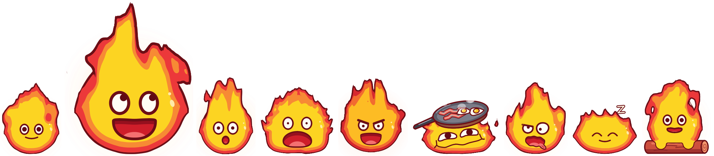

<p align="center">
  
</p>

<h1 align="center">Lavenzure Desktop Pet</h1>

<p align="center">
  <em>A little fire demon that moves onto your desktop, and never sits still.</em><br>
  <a href="./README_vi.md">Tiếng Việt</a> · <b>English</b>
</p>

---

Lavenzure is a pocket-sized flame spirit that lives on top of your windows. It wanders around, hops, dozes off when you leave and reacts when you click or pick it up. Right-click it to chat: an AI answers in your language, checks the weather, searches the web, reminds you of things, and pulls a face that matches every reply.

<p align="center">
  
</p>

**There is not a single image file in this character.** The fire, every blink and every grin is drawn in code, live, and never plays the same frame twice.

## Features

- **Alive on your desktop**: Always on top, transparent, click-through everywhere except the flame. It idles, walks, flies around on a log, jumps, falls asleep after 10 minutes without you, and has a calmer look at night.
- **Expressive**: A GPU-shader flame and a face with real acting (the eyes follow your mouse; happy, surprised, scared, angry, chill, sleepy…).
- **Chat with an AI agent** (Google Gemini or OpenAI, your choice) with tools for **weather**, **web search**, **PC status** (CPU / RAM / battery) and **reminders** ("remind me at 11:00 to…").
- **Looks after you**: Alerts when the battery, CPU or RAM get critical, and every 5 minutes it says a caring line, a fun fact or a joke.
- **English or Vietnamese** for everything it says (Settings).
- **Outfits** (Settings → Outfit): Pick the costume your pet wears. The current version ships the **Christmas outfit** (a knitted scarf, a snowy log and festive greetings) next to the normal look, and more outfits are planned.
- **Private**: The chat lives in RAM only, and your API keys are kept in the Windows Credential Manager.

## Download and run (Windows 10/11)

1. Download `Lavenzure-<version>-win-x64.zip` from the [Releases](../../releases) page and unzip it anywhere.
2. Double-click `Lavenzure.exe`. The pet appears and an icon shows up in the system tray.
3. Right-click the tray icon → **Settings**, pick your **Chat AI** and paste its API key. The key is checked first, then saved, and works at once.
   - **Gemini**: Get a free key from [Google AI Studio](https://aistudio.google.com/apikey).
   - **OpenAI**: Get a key from the [OpenAI platform](https://platform.openai.com/api-keys).
   - **Tavily** (optional, for web search): [tavily.com](https://tavily.com).
4. Optional: Turn on **Start with Windows** in Settings.

Without a key the pet still runs; only the chat needs one.

> **Windows may warn you** ("Windows protected your PC") because the app is not code-signed. Click **More info → Run anyway**. Each release lists the SHA-256 of the zip so you can check your download (`Get-FileHash Lavenzure-<version>-win-x64.zip`).

## User guide

### 1. Meet your pet

| Action | Result |
|---|---|
| Left-click | The pet reacts. It also dismisses an alert or reminder that is waiting |
| Press and drag | Carry the pet somewhere else |
| Right-click | Open the pet menu |

Leave it alone and it wanders around on its own. Its eyes follow your mouse.

### 2. The pet menu (right-click the pet)

| Item | What it does |
|---|---|
| **Chat** | Open the chat bubble |
| **Idle** / **Wander** | Let the pet sleep, or wake it up to roam again |
| **Hide Pet** | Hide the pet (it keeps working in the background) |

### 3. The tray icon (bottom-right of the taskbar)

The pet keeps a small icon in the system tray. On Windows 11 it may sit behind the **^** arrow. Right-click it:

| Item | What it does |
|---|---|
| **Show Pet** | Bring a hidden pet back |
| **Settings** | Open the Settings window |
| **Quit App** | Close Lavenzure |

### 4. Chat

Right-click the pet → **Chat**, type your message and press **Enter**. Write in any language: The pet answers in yours. Press **Esc** or **x** to close the bubble.

Besides chatting, the pet can check the weather, search the web (needs a Tavily key), tell you how your PC is doing and set reminders. Just ask. Chat needs an API key (see Settings → Chat AI); everything else works without one.

### 5. Reminders

Tell the pet in the chat, for example **"Remind me at 21:00 to submit the report"** or **"Remind me in 30 minutes to stretch"**. Open the **Reminders** tab of the chat bubble to see or remove what is waiting. When the time comes, the pet pops out and reminds you; left-click it to dismiss.

### 6. Alerts and chit-chat

If your battery, CPU or RAM gets critical, the pet warns you until you left-click it. Now and then it also talks to you on its own.

### 7. Settings (tray icon → Settings)

| Section | What it does |
|---|---|
| **Language** | Choose English or Tiếng Việt for what the pet says |
| **Outfit** | Choose what the pet wears (Normal or Christmas) |
| **Chat AI** | Choose Gemini or OpenAI, paste the API key and press **Save**. An optional Tavily key turns on web search |
| **Startup** | Start the pet with Windows |
| **Performance** | Choose 30 or 60 fps (30 is lighter on your PC) |

### 8. Troubleshooting

- **The pet disappeared**: It is hidden. Use the tray icon → **Show Pet**.
- **The chat shows an error**: Check your API key in Settings → Chat AI, and your internet connection.
- **Anything else**: See the log at `%LOCALAPPDATA%\Lavenzure\logs\lavenzure.log`.

## Run from source

Needs [uv](https://docs.astral.sh/uv/) on Windows (it also installs Python 3.13 for you).

```powershell
uv sync                    # creates .venv with the exact versions from uv.lock
uv run python src\main.py
```

For development you can put the keys in a `.env` file instead of Settings (`copy .env.example .env`); keys from `.env` or the environment override the saved ones.

```powershell
uv run pytest                           # tests (no display needed)
uv run ruff check .                     # lint
uv run python scripts\build.py          # build dist\Lavenzure-<version>-win-x64.zip
uv add <package>                        # add a dependency (updates pyproject.toml and uv.lock)
```

Settings you may want to change live in [`config.yaml`](./config.yaml) (character size, frame rate, flame renderer, alert thresholds, AI models, how often the pet talks). Your own choices from the Settings window are saved in `%LOCALAPPDATA%\Lavenzure\settings.json`.

Releases are made by pushing a tag such as `v0.1.0` (see `.github/workflows/release.yml`); the version number always comes from the git tag.

## Project layout

```
src/
├── main.py            # entry point; wires everything together with Qt signals
├── overlay/           # pet window, character, face, flame renderers, behavior, speech bubble
├── chat/              # chat bubble
├── agent/             # LangGraph agent (Gemini / OpenAI), tools, key checks, session memory
├── monitor/           # system alerts, reminders, ambient lines, idle / night
├── ui/                # menus, tray icon, Settings window
└── api_keys.py, version.py, paths.py, autostart/ ...
tests/  data/  assets/  scripts/  docs/
```

The design documents in [`docs/`](./docs) (decisions, plan, test checklist) are written in Vietnamese; [`CLAUDE.md`](./CLAUDE.md) and the [`pet-animation` skill](./.claude/skills/pet-animation/SKILL.md) guide AI coding agents working in this repo.

## License

Free and non-commercial, released under the [MIT License](./LICENSE). Lavenzure is inspired by Calcifer, a Studio Ghibli character; this is an unofficial fan work that uses no original film assets and is not affiliated with Studio Ghibli.
