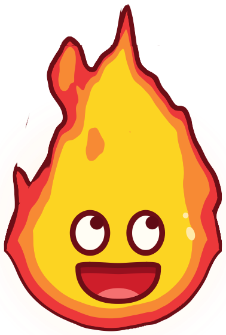
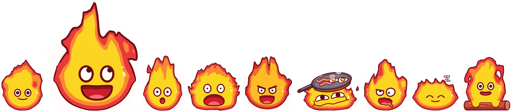

<p align="center">
  
</p>

<h1 align="center">Calcifer Desktop Pet</h1>

<p align="center">
  <em>A little fire demon that moves onto your desktop, and never sits still.</em><br>
  <a href="./README_vi.md">Tiếng Việt</a> · <b>English</b>
</p>

---

A pocket-sized flame spirit, a fan-art tribute to Calcifer, that lives on top of all your windows. It wanders along the bottom of the screen, hops, summons a log and flies off on it, dozes off when you leave, pulls a random trick when you click it and looks startled when you pick it up. Right-click and it opens a chat bubble, where an AI agent (Google Gemini) answers in your language and checks the weather, searches the web or tells you how hard your PC is working, pulling a face that matches every reply.

**There is not a single image file in this character.** Every flicker of fire, every blink and every grin is computed in code, live, 60 times a second, and it never plays the same frame twice.

> **Personal use only.** Calcifer is a copyrighted Studio Ghibli character. This project is non-commercial fan-art, uses no original film assets, and must not be distributed publicly or commercially.

## The animation

<p align="center">
  
  <br>
  <sub>normal · happy · surprised · scared · angry · chill · yuck · asleep · riding the log, all frames straight from the live renderer</sub>
</p>

The goal was a flat, hand-inked "sticker" look that *moves* like real fire and *acts* like a character with a personality. Under the hood:

### 🔥 Fire that never repeats

- **A GPU shader burns the flame.** A GLSL fragment shader computes a "heat" field for every pixel: a round body plus a teardrop cone, eaten away by **domain-warped 3D fractal noise that scrolls upward**. Tongues of fire are born on the body, rise, stretch, split, pinch off into little scraps and die out. Because the noise has a time axis, the pattern never loops.
- **Sticker style, rendered for real.** The heat is cut into three flat bands (red rim, orange, yellow core) and wrapped in a dark maroon ink line of *constant* width: the shader divides by the heat gradient, so the outline doesn't swell where the fire is soft. Every edge is anti-aliased.
- **Fire "weather".** The flame drifts between moods of its own, a steady *calm*, a tall swaying *gust*, a short jittery *crackle* and a low lazy *lull*, each lasting a random time, while the dominant tip wanders from side to side. You never get a metronome.
- **The face stays calm.** The noise is weak on the lower body and strong near the tips, so the face always sits on smooth yellow while the crown goes wild.
- **Three interchangeable renderers.** Besides the shader there is a CPU **metaball** renderer (particle tongues melted into a density field and traced into vector outlines) and a **baked** one (clips of a real 2D stable-fluids simulation, computed offline and morphed into each other). If OpenGL 3.3 is missing, the pet quietly falls back to metaballs.

### 🎭 A face with acting, not just switching

- **Overlapping timing.** The eyes react first and the mouth follows a beat later, the way animators stagger a "take", instead of everything snapping in the same frame.
- **Springs and anticipation.** Every face parameter is a spring with a touch of overshoot (eyes *pop* when surprised), and each change of mood starts with a tiny squeeze the other way.
- **Real eyelids.** Upper lids droop or slant for sleepy, cross or worried looks; cheeks push the lower lids up when it smiles; blinks close fast and open slowly.
- **The head turns.** The features sit on an imaginary sphere: when it glances sideways, the whole face slides over and the far side narrows. The eyes follow your mouse cursor and dart around with small saccades.
- **Idle micro-expressions.** Left alone, it drifts through little moods at irregular times: a smug smirk, a content squint, a small "o", a yawn, a worried wiggle.
- **Mouths that morph.** Going from a smile to an "o" to a shout is one continuous shape, not a cross-fade between drawings. The happy and chill faces are traced point by point from reference sketches and blended in.
- **Expressions reshape the whole fire.** *Scared* bristles into a boxy blaze, *angry* flares out at the sides, *chill* flattens under a frying pan with sizzling egg and bacon, *asleep* sinks low and wide, breathing slowly, with drifting "z"s. Shape values are springs too, so the fire wobbles like jelly between poses.

### 🪵 Body language from real movement

- **Nothing is keyframed.** Lean, stretch, squash and hops are *derived from how the window actually moves*: the flame trails against its direction of travel, stretches when it shoots up or drops, squashes and wobbles when it lands, and bounces as it walks. Wind from moving blows the fire backwards.
- **Sparks live in screen space.** Embers keep rising from where they were spawned, so they stream out behind the pet as it travels.
- **Props with entrances.** A log appears in a burst of sparks at take-off, little flame paws grip it while it flies, and it dissolves into embers on landing.
- **Butter-smooth motion.** The window position is tracked with sub-pixel precision (the leftover fraction becomes a drawing offset), and the frame loop runs on the same Qt animation clock as the movement, so a slow walk glides instead of stepping 1 px, 2 px, 1 px.
- **It has a day and a night.** From 20:00 to 05:00 the fire burns lower, slower and deeper red; after 10 minutes without mouse or keyboard it yawns, its eyes slowly close and it nods off, then pops awake when you come back.

## Features

- **Character drawn entirely in code** with a GPU-shader flame and an expressive face (see [The animation](#the-animation)): happy (two faces), surprised, scared, angry, chill, yuck, thinking, alert, sleeping.
- **Moves on its own**: idles, walks along the bottom of the screen, flies around on a log, jumps — picked at random.
- **Sleeps**: lies down and sleeps (slow breathing, floating "z"s) when you choose `Idle`, and dozes off by itself after 10 minutes without mouse/keyboard input, waking up when you come back.
- **Night look**: from 20:00 to 05:00 the fire is calmer and dimmer and the pet moves slower.
- **Always on top, transparent, click-through**: only the visible flame catches the mouse; the empty area around it passes clicks to the app underneath.
- **Mouse interaction**: left-click → a random animation (never the same twice in a row); press and drag → carry the pet; right-click → a small menu with `Chat` and `Idle` / `Wander`.
- **Speech bubbles follow the pet** as it moves.
- **Chat with an AI agent** (LangGraph + Google Gemini `gemini-flash-latest`) that answers in your language, picks an emotion for each reply (the pet shows that face for a few seconds) and has 3 tools:
  - `weather` — current weather for a place name (Open-Meteo, no key needed)
  - `web_search` — web search (Tavily)
  - `system_status` — current CPU / RAM / battery
  - (reminders are switched off for now)
- **Chat bubble** in warm flame colours, attached to the pet (it stands still while the bubble is open), renders Markdown, closes with Esc or by itself after 30 seconds without chatting (not while you type or the AI answers).
- **Clear error messages**: a missing/invalid key, exhausted quota, no internet… the pet explains it in the chat instead of failing silently or crashing.
- **Background monitoring**: alerts when battery < 30%, CPU > 90% or RAM > 90%; the alert stays until you click the pet.
- **Ambient lines**: after 15 minutes without interaction the pet says a random fact or joke.
- **Chat history lives in RAM only** and is wiped after 15 minutes without chatting — nothing is written to disk.
- **System tray icon** (a portrait of the pet): `Hide Pet` / `Show Pet`, `Settings` (empty for now), `Quit App`.
- **Single instance**: starting the app again just opens the running pet's chat bubble.

## Requirements

- Windows 10/11, single monitor.
- Python 3.13 (Windows build).
- A GPU with OpenGL 3.3 (optional — otherwise the fallback renderer is used).
- API keys:
  - `GEMINI_API_KEY` — from [Google AI Studio](https://aistudio.google.com/apikey) (needed for chat; without it the pet still runs, only the chat is unavailable).
  - `TAVILY_API_KEY` — from [tavily.com](https://tavily.com) (for the web search tool).

## Installation

Open PowerShell in the project folder:

```powershell
py -3.13 -m venv .venv-win
.venv-win\Scripts\python.exe -m pip install -r requirements.txt
copy .env.example .env      # then open .env and fill in both API keys
```

## Running

```powershell
.venv-win\Scripts\python.exe src\main.py
```

Start automatically with Windows (creates a shortcut in the Startup folder that runs `pythonw.exe`, so no console window appears):

```powershell
.venv-win\Scripts\python.exe src\autostart\install_startup.py
```

To turn autostart off, delete `Calcifer.lnk` from `shell:startup` (type `shell:startup` in the Run dialog).

If something goes wrong, check the log file: `%LOCALAPPDATA%\Calcifer\logs\calcifer.log`.

## Usage

| Action | Result |
|---|---|
| Left-click the pet | A random animation; during an alert it only clears the alert |
| Press and drag | Carry the pet somewhere else |
| Right-click the pet | Menu: `Chat` (open the chat bubble), `Idle` (sleep) / `Wander` (roam again) |
| Esc in the chat bubble | Close the chat (history is kept for 15 minutes) |
| System tray icon | Hide/show the pet, Settings, quit |

## Configuration

Non-secret settings live in [`config.yaml`](./config.yaml):

| Key | Meaning |
|---|---|
| `llm.model`, `llm.temperature` | Gemini model used for chat (default `gemini-flash-latest`) |
| `llm.timeout_seconds`, `llm.max_retries` | How long to wait / how often to retry before reporting an error |
| `character.scale` | Character size (0.75 = 150×177 px) |
| `character.fps` | Frames per second; lower it to 30 to save CPU |
| `character.flame_renderer` | Flame body renderer: `shader` (default, GPU) / `metaball` / `baked` |
| `behavior.state_weights` | How often the pet idles / walks / floats / jumps |
| `system_status.*` | Polling interval and alert thresholds |
| `ambient.random_fact_or_joke.idle_minutes` | Idle time before the pet says something on its own |
| `chat.reply_bubble_max_chars` | Replies up to this length also appear in the bubble (0 = off) |
| `memory.idle_timeout_minutes` | Idle time before the chat history is wiped |

Click reactions and the fact/joke pool live in `data/click_reactions.json` and `data/facts_jokes.json` (always in English).

## Development

The repo uses two virtual environments (neither is committed):

- `.venv-win` — Windows Python, used to run the real app. It can be called from WSL too; windows open on the Windows desktop.
- `.venv` — Linux Python (optional), only for quick animation previews through WSLg; don't use it to judge transparency or click-through.

```bash
.venv-win/Scripts/python.exe -m pip install -r requirements-dev.txt  # adds pytest + ruff
.venv-win/Scripts/python.exe -m pytest                            # run the tests (no display needed)
.venv-win/Scripts/python.exe -m ruff check .                      # lint
.venv-win/Scripts/python.exe src/character_preview.py [renderer]  # try every mood/motion, compare flame renderers
.venv-win/Scripts/python.exe src/perf_check.py --minutes 60  # measure CPU / RAM / GPU of the real app
.venv-win/Scripts/python.exe src/desktop_check.py              # check always-on-top / click-through of the running pet
.venv-win/Scripts/python.exe src/bake_flame.py                    # regenerate the data for the `baked` renderer
QT_QPA_PLATFORM=offscreen WSLENV=QT_QPA_PLATFORM .venv-win/Scripts/python.exe src/main.py  # headless smoke run
```

Notes:

- `src/` is the import root (`import config`, `from overlay.x import ...`).
- When calling Windows Python from WSL, environment variables are only passed through if listed in `WSLENV` (as above).
- Keep each file's existing line endings (CRLF or LF) when editing.
- There is no packaged `.exe` yet (planned for later).

## Project layout

```
src/
├── main.py                 # entry point; wires all components together with Qt signals
├── config.py               # reads config.yaml + .env
├── app_logging.py          # logging to a rotating file
├── single_instance.py      # allows only one running pet
├── character_preview.py    # preview window for the character
├── bake_flame.py           # offline fire simulation for the `baked` renderer
├── overlay/                # pet window, character, face, 3 flame renderers, behavior, speech bubble
├── chat/                   # chat bubble
├── agent/                  # LangGraph agent, tools, session memory, error handling
├── monitor/                # system alerts, reminders, ambient lines, user idle time / night
├── ui/                     # themed menus, tray icon, Settings window
└── autostart/              # Windows Startup shortcut
tests/                      # automated tests (pytest)
docs/                       # design docs (Vietnamese)
data/                       # click reactions + fact/joke pool
assets/flame/               # pre-computed fire data for the `baked` renderer
```

## Design docs

The design documents are written in Vietnamese:

- [`docs/CONTEXT.md`](./docs/CONTEXT.md) — goals, architecture, locked technical decisions, change log.
- [`docs/implementation_plan.md`](./docs/implementation_plan.md) — progress and the **next-steps roadmap**.
- [`docs/DECISION_LOG.md`](./docs/DECISION_LOG.md) — log of the decisions agreed so far (and the ones still open).
- [`docs/TEST_CHECKLIST.md`](./docs/TEST_CHECKLIST.md) — real-desktop test checklist and performance measurements.
- [`CLAUDE.md`](./CLAUDE.md) — guidance for AI coding agents working in this repo (English).
- [`docs/ANIMATION_TUTORIAL.md`](./docs/ANIMATION_TUTORIAL.md) — the abandoned PNG-cutout approach, kept for reference only.

## Status (2026-11-12)

- Character, movement, click/drag, tray icon, system monitoring and chat with all 4 tools work (chat moved to `gemini-flash-latest` after Google shut down `gemini-2.0-flash`).
- New: chat bubble, click animation pool, right-click menu, new expressions with emotion chosen by the AI, flying on a log, sleeping / dozing, night look, tray icon drawn from the character.
- 85 automated tests and ruff linting.
- Still to do: long-term testing on the real desktop; Settings content and real arms (E3) (awaiting a decision); `.exe` packaging (later).
