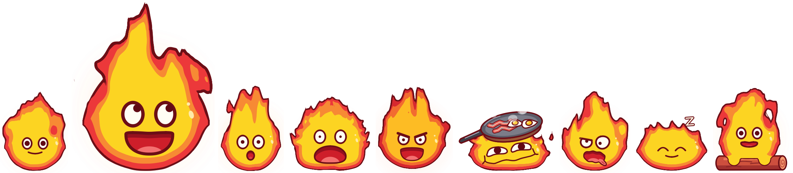

<p align="center">
  
</p>

<h1 align="center">Lavenzure Desktop Pet</h1>

<p align="center">
  <em>Một con quỷ lửa bé xíu dọn đến sống trên màn hình của bạn, và chẳng bao giờ chịu ngồi yên.</em><br>
  <b>Tiếng Việt</b> · <a href="./README.md">English</a>
</p>

---

Lavenzure là một linh hồn lửa nhỏ bằng bàn tay, sống nổi trên mọi cửa sổ của bạn. Nó đi dạo, nhún nhảy, ngủ gật khi bạn rời máy và phản ứng khi bạn click hay nhấc nó lên. Chuột phải để chat: một AI trả lời theo ngôn ngữ bạn gõ, xem thời tiết, tìm kiếm web, nhắc việc, và mỗi câu trả lời lại đi kèm một nét mặt hợp cảnh.

<p align="center">
  
</p>

**Nhân vật này không dùng một file ảnh nào.** Ngọn lửa, từng cái chớp mắt, từng nụ cười đều được vẽ bằng code, trực tiếp, và không bao giờ lặp lại cùng một khung hình.

## Tính năng

- **Sống trên màn hình**: luôn nằm trên cùng, trong suốt, chuột xuyên qua mọi chỗ trừ ngọn lửa. Nó đứng yên, đi dạo, cưỡi củi bay, nhảy, ngủ gật sau 10 phút bạn không đụng máy, và dịu lại vào ban đêm.
- **Biểu cảm**: ngọn lửa vẽ bằng shader GPU cùng khuôn mặt có "diễn xuất" thật (mắt nhìn theo con trỏ chuột; vui, ngạc nhiên, sợ, giận, chill, buồn ngủ…).
- **Chat với AI agent** (Google Gemini hoặc OpenAI, bạn chọn) có sẵn công cụ **thời tiết**, **tìm kiếm web**, **tình trạng máy** (CPU / RAM / pin) và **nhắc việc** ("nhắc tôi lúc 11:00 làm…").
- **Quan tâm bạn**: cảnh báo khi pin, CPU hoặc RAM ở mức nguy hiểm; cứ 5 phút lại nói một câu quan tâm, một sự thật thú vị hoặc một câu đùa.
- **Tiếng Anh hoặc tiếng Việt** cho mọi câu nó nói (trong Settings).
- **Nhiều trang phục** (Settings → Outfit): bạn chọn bộ đồ cho pet. Phiên bản hiện tại có **trang phục Giáng sinh** (khăn len, khúc gỗ phủ tuyết và lời chúc mừng) bên cạnh diện mạo thường, và sẽ có thêm các trang phục khác.
- **Riêng tư**: cuộc trò chuyện chỉ nằm trong RAM, khóa API được cất trong Windows Credential Manager.

## Tải về và chạy (Windows 10/11)

1. Tải `Lavenzure-<phiên bản>-win-x64.zip` ở trang [Releases](../../releases) rồi giải nén vào thư mục bất kỳ.
2. Bấm đúp `Lavenzure.exe`. Pet hiện ra và có thêm một biểu tượng ở khay hệ thống.
3. Chuột phải biểu tượng khay → **Settings**, chọn **Chat AI** rồi dán khóa API của nó. Khóa được kiểm tra trước, rồi mới lưu, và dùng được ngay.
   - **Gemini**: lấy khóa miễn phí ở [Google AI Studio](https://aistudio.google.com/apikey).
   - **OpenAI**: lấy khóa ở [OpenAI platform](https://platform.openai.com/api-keys).
   - **Tavily** (tùy chọn, để tìm kiếm web): [tavily.com](https://tavily.com).
4. Tùy chọn: bật **Start with Windows** trong Settings.

Chưa có khóa thì pet vẫn chạy bình thường; chỉ phần chat cần khóa.

> **Windows có thể cảnh báo** ("Windows protected your PC") vì app chưa được ký số. Bấm **More info → Run anyway**. Mỗi bản phát hành đều kèm mã SHA-256 của file zip để bạn kiểm tra file tải về (`Get-FileHash Lavenzure-<phiên bản>-win-x64.zip`).

## Hướng dẫn sử dụng

### Bản thân chú pet

| Thao tác | Kết quả |
|---|---|
| Click chuột trái | Một phản ứng ngẫu nhiên (đổi nét mặt, nói một câu, kể chuyện cười). Cũng tắt cảnh báo hoặc nhắc việc đang chờ |
| Nhấn giữ và kéo | Bế pet lên và mang sang chỗ khác; thả ra là pet rơi xuống |
| Chuột phải | Mở menu của pet (bên dưới) |
| Không làm gì | Pet tự đi lại, nhảy và bay quanh trên khúc củi. Mắt pet nhìn theo con trỏ chuột |

Sau **10 phút** bạn không đụng chuột hay bàn phím, pet sẽ ngủ gật. Thao tác đầu tiên của bạn sẽ đánh thức pet, và pet nói "Welcome back!" kèm thời gian bạn vắng mặt. Từ 20:00 đến 05:00 pet trông dịu hơn và di chuyển chậm hơn (pet không tự đi ngủ chỉ vì đồng hồ).

### Menu của pet (chuột phải vào pet)

| Mục | Tác dụng |
|---|---|
| **Chat** | Mở bong bóng chat bên cạnh pet |
| **Idle** | Cho pet nằm xuống ngủ cho đến khi bạn chọn **Wander** (cùng một mục, đổi tên) |
| **Wander** | Đánh thức pet và cho pet đi lại tiếp |
| **Hide Pet** | Ẩn pet. Chat, nhắc việc và cảnh báo vẫn chạy ngầm |

### Biểu tượng ở khay hệ thống (góc phải dưới thanh taskbar)

Pet đặt một biểu tượng nhỏ của mình ở khay hệ thống. Trên Windows 11 biểu tượng có thể nằm sau mũi tên **^**; kéo nó ra ngoài để luôn thấy. Bấm chuột phải vào biểu tượng:

| Mục | Tác dụng |
|---|---|
| **Show Pet** | Chỉ hiện khi pet đang bị ẩn: gọi pet ra lại |
| **Settings** | Mở cửa sổ Settings (bên dưới) |
| **Quit App** | Tắt hẳn Lavenzure |

Nếu không thấy pet đâu, nhiều khả năng pet đang bị ẩn: dùng **Show Pet** ở biểu tượng khay.

### Chat

1. Chuột phải vào pet → **Chat**. Một bong bóng thoại mở ra cạnh pet và đi theo pet khi bạn kéo.
2. Gõ vào ô ở dưới cùng rồi nhấn **Enter**. Câu trả lời hiện dần ra, và pet đổi nét mặt cho hợp với câu trả lời.
3. Cuộn lên để đọc lại tin cũ. Nhấn **Esc** hoặc nút **x** để đóng bong bóng.

Cần biết:

- Bạn viết bằng ngôn ngữ nào, pet trả lời bằng ngôn ngữ đó.
- Bong bóng tự đóng sau 30 giây không chat (nếu chuột bạn đang đặt trên bong bóng thì nó chờ).
- Cuộc trò chuyện chỉ nằm trong RAM và bị xóa sau 15 phút không chat. Không có gì được lưu xuống ổ đĩa.
- Chat cần API key (xem Settings → Chat AI). Chưa có khóa thì pet vẫn chạy; chỉ phần chat bị tắt.

Bạn có thể nhờ pet (AI tự chọn công cụ phù hợp):

| Nhờ gì | Ví dụ | Cần |
|---|---|---|
| Thời tiết | "Thời tiết ở Hà Nội thế nào?" | không cần gì (miễn phí) |
| Tìm kiếm web | "Tìm tin mới nhất về …" | khóa Tavily (tùy chọn) |
| Tình trạng máy | "Pin / CPU / RAM của mình sao rồi?" | không cần gì |
| Nhắc việc | "Nhắc mình 11 giờ gọi điện cho mẹ" | không cần gì |

### Nhắc việc

- Cứ nói trong chat: **"nhắc mình sau 30 phút đứng dậy vận động"** hoặc **"nhắc mình lúc 21:00 nộp báo cáo"**. Giờ đã qua trong hôm nay sẽ được hiểu là ngày mai. Đặt trước được tối đa 7 ngày.
- Nếu bạn không nói giờ hoặc nói mơ hồ ("tối nay", "lát nữa"), pet sẽ hỏi lại và gợi ý một giờ (sáng 08:00, trưa 12:00, chiều 15:00, tối 20:00, khuya 22:00).
- Khi nhắc việc thật sự được đặt, trong chat hiện một ghi chú nhỏ ("⏰ Reminder set: Today 21:00 · call mom"), để bạn biết pet không chỉ hứa suông.
- Mở tab **Reminders** ở đầu bong bóng chat để xem những việc đang chờ (việc sớm nhất ở trên). Bấm **x** cạnh một việc để xóa, hoặc nhắn trong chat: "hủy nhắc việc gọi mẹ".
- Khi đến giờ, pet chạy ra dù đang bị ẩn hay đang ngủ, bật đồng hồ báo thức và nói lời nhắc bằng giọng của mình. Bong bóng nằm đó cho đến khi bạn **click chuột trái vào pet**.
- Nhắc việc được lưu xuống đĩa nên vẫn còn sau khi tắt app hoặc khởi động lại máy. Nếu giờ nhắc trôi qua lúc app đang tắt, lần mở sau pet sẽ nhắc và báo trễ bao nhiêu phút.

### Cảnh báo và những câu pet tự nói

- **Cảnh báo**: cứ 45 giây pet kiểm tra máy một lần. Nếu pin xuống còn 30% hoặc thấp hơn, hay CPU hoặc RAM đạt 90%, pet làm mặt báo động và hiện bong bóng nằm đó cho đến khi bạn click chuột trái vào pet. Sau khi bạn tắt cảnh báo, pet im lặng 10 phút. Các ngưỡng nằm trong [`config.yaml`](./config.yaml).
- **Tự nói**: khoảng 5 phút một lần pet nói một câu quan tâm (lời chào buổi sáng, nhắc nghỉ ngơi…), một sự thật thú vị hoặc một câu đùa, lần lượt thay nhau. Pet im lặng khi đang bị ẩn, đang ngủ hoặc khi bạn đang chat.

### Settings (biểu tượng khay → Settings)

Lựa chọn của bạn được nhớ cho những lần chạy sau.

| Mục | Tùy chọn |
|---|---|
| **Language** | English hoặc Tiếng Việt: ngôn ngữ pet nói trên màn hình (phản ứng, câu quan tâm, cảnh báo, nhắc việc). Câu trả lời trong chat theo ngôn ngữ bạn viết |
| **Outfit** | Normal hoặc Giáng sinh (khăn len, khúc củi phủ tuyết, thỉnh thoảng có lời chúc lễ) |
| **Chat AI** | Chọn **Gemini** hoặc **OpenAI**, dán API key rồi bấm **Save**: khóa được kiểm tra trước, sau đó lưu lại và dùng được ngay (**Show** / **Hide** để xem khóa, **Remove** để xóa). Khóa **Tavily** (tùy chọn) bật tính năng tìm kiếm web. Khóa được lưu trong Windows Credential Manager, không nằm trong file nào |
| **Startup** | **Start with Windows**: pet xuất hiện mỗi lần bạn đăng nhập (mặc định tắt) |
| **Performance** | Tốc độ khung hình **30** hoặc **60 fps**. 30 nhẹ máy hơn; dòng bên dưới cho biết fps thực tế đang vẽ |

### Xử lý sự cố

- **Pet biến mất**: pet đang bị ẩn; biểu tượng khay → **Show Pet**. Nếu không thấy biểu tượng khay, tìm sau mũi tên **^** của taskbar.
- **Chat báo có lỗi**: kiểm tra khóa trong Settings → Chat AI (**Save** sẽ báo nếu khóa bị từ chối), kết nối mạng và hạn mức API của bạn.
- **Mở Lavenzure lần thứ hai**: chỉ chạy một bản; mở lại sẽ chỉ bật chat của bản đang chạy.
- **Việc khác**: file log ở `%LOCALAPPDATA%\Lavenzure\logs\lavenzure.log`.

## Chạy từ mã nguồn

Cần [uv](https://docs.astral.sh/uv/) trên Windows (uv cũng tự cài Python 3.13 cho bạn).

```powershell
uv sync                    # tạo .venv với đúng phiên bản thư viện ghi trong uv.lock
uv run python src\main.py
```

Khi phát triển có thể để khóa trong file `.env` thay vì Settings (`copy .env.example .env`); khóa trong `.env` hoặc biến môi trường sẽ đè lên khóa đã lưu.

```powershell
uv run pytest                           # chạy test (không cần màn hình)
uv run ruff check .                     # kiểm tra lint
uv run python scripts\build.py          # tạo dist\Lavenzure-<phiên bản>-win-x64.zip
uv add <gói>                            # thêm thư viện (cập nhật pyproject.toml và uv.lock)
```

Những thứ hay chỉnh nằm trong [`config.yaml`](./config.yaml) (cỡ nhân vật, tốc độ khung hình, kiểu vẽ lửa, ngưỡng cảnh báo, model AI, tần suất pet nói). Lựa chọn của bạn trong cửa sổ Settings được lưu ở `%LOCALAPPDATA%\Lavenzure\settings.json`.

Bản phát hành được tạo khi đẩy một tag như `v0.1.0` (xem `.github/workflows/release.yml`); số phiên bản luôn lấy từ git tag.

## Cấu trúc dự án

```
src/
├── main.py            # điểm vào; nối mọi thành phần bằng tín hiệu Qt
├── overlay/           # cửa sổ pet, nhân vật, khuôn mặt, các kiểu vẽ lửa, hành vi, bong bóng thoại
├── chat/              # bong bóng chat
├── agent/             # LangGraph agent (Gemini / OpenAI), công cụ, kiểm tra khóa, bộ nhớ phiên
├── monitor/           # cảnh báo hệ thống, nhắc việc, câu tự nói, thời gian rảnh / ban đêm
├── ui/                # menu, biểu tượng khay, cửa sổ Settings
└── api_keys.py, version.py, paths.py, autostart/ ...
tests/  data/  assets/  scripts/  docs/
```

Các tài liệu thiết kế trong [`docs/`](./docs) (quyết định, kế hoạch, checklist kiểm thử) viết bằng tiếng Việt; [`CLAUDE.md`](./CLAUDE.md) và [skill `pet-animation`](./.claude/skills/pet-animation/SKILL.md) hướng dẫn các AI coding agent làm việc trong repo này.

## Giấy phép

Miễn phí và phi thương mại, phát hành theo [giấy phép MIT](./LICENSE). Lavenzure lấy cảm hứng từ Calcifer, nhân vật của Studio Ghibli; đây là sản phẩm hâm mộ không chính thức, không dùng tài nguyên gốc của phim và không liên kết với Studio Ghibli.
