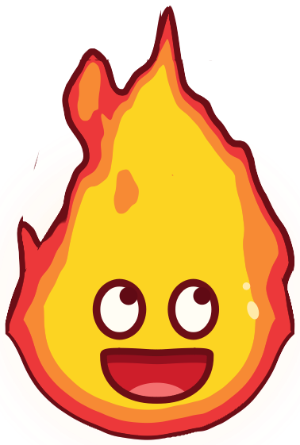
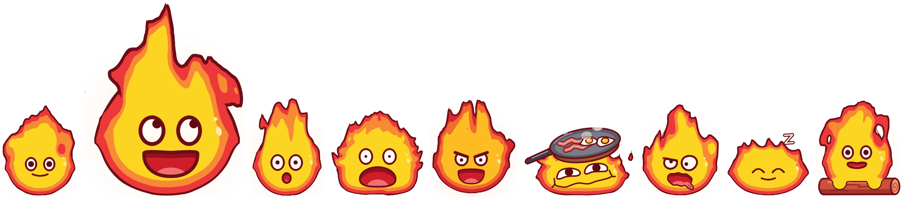

<p align="center">
  
</p>

<h1 align="center">Lavenzure Desktop Pet</h1>

<p align="center">
  <em>Một con quỷ lửa bé xíu dọn đến sống trên màn hình của bạn, và chẳng bao giờ chịu ngồi yên.</em><br>
  <b>Tiếng Việt</b> · <a href="./README.md">English</a>
</p>

---

Một linh hồn lửa nhỏ bằng bàn tay, lấy ý tưởng từ nhân vật Calcifer của Studio Ghibli, sống nổi trên mọi cửa sổ. Nó đi dạo dọc đáy màn hình, nhún nhảy, gọi khúc củi rồi cưỡi củi bay vèo đi, ngủ gật khi bạn rời máy, bày trò ngẫu nhiên khi bạn click và giật mình khi bị nhấc lên. Chuột phải là mở bong bóng chat: một AI agent (Google Gemini) trả lời theo ngôn ngữ bạn gõ, xem thời tiết, tìm kiếm web hay cho bạn biết máy đang vất vả cỡ nào, và mỗi câu trả lời lại đi kèm một nét mặt hợp cảnh.

**Nhân vật này không dùng một file ảnh nào.** Từng đợt lửa bập bùng, từng cái chớp mắt, từng nụ cười đều được tính bằng code, trực tiếp, 60 lần mỗi giây, và không bao giờ lặp lại cùng một khung hình.

> **Chỉ dùng cá nhân.** Ý tưởng của Lavenzure được lấy cảm hứng từ Calcifer, nhân vật có bản quyền của Studio Ghibli. Dự án này là sản phẩm hâm mộ phi thương mại, không dùng bất kỳ hình ảnh/âm thanh gốc nào của phim, và không được phát hành công khai hay thương mại.

## Hoạt ảnh

<p align="center">
  
  <br>
  <sub>bình thường · vui · ngạc nhiên · hoảng · giận · chill · ghê · ngủ · cưỡi củi, tất cả là khung hình lấy thẳng từ bộ vẽ đang chạy</sub>
</p>

Mục tiêu: nét vẽ phẳng, viền mực như sticker vẽ tay, nhưng *chuyển động* như lửa thật và *diễn* như một nhân vật có tính cách. Bên dưới là:

### 🔥 Ngọn lửa không bao giờ lặp lại

- **Lửa được đốt bằng GPU shader.** Một fragment shader GLSL tính "độ nóng" cho từng pixel: thân tròn cộng một chóp hình giọt nước, bị gặm mòn bởi **nhiễu fractal 3D bẻ cong miền (domain warping) cuộn dần lên trên**. Lưỡi lửa sinh ra trên thân, bốc lên, kéo dài, tách đôi, đứt thành mẩu nhỏ rồi tắt. Nhiễu có cả trục thời gian nên hoa văn không bao giờ lặp vòng.
- **Phong cách sticker, nhưng vẽ thật.** Độ nóng được cắt thành ba dải màu phẳng (viền đỏ, cam, lõi vàng) và bao quanh bằng một nét mực nâu đậm dày *đều*: shader chia cho gradient của độ nóng nên viền không phình to ở chỗ lửa mềm. Mọi mép đều được khử răng cưa.
- **"Thời tiết" của lửa.** Ngọn lửa tự chuyển qua lại giữa các trạng thái: *cháy đều*, *bùng gió* cao và lắc lư, *lách tách* ngắn và giật, *lặng* thấp và lười, mỗi trạng thái kéo dài ngẫu nhiên, còn chóp lửa chính thì trôi qua trôi lại. Không bao giờ đều đều như máy đếm nhịp.
- **Mặt luôn nằm yên.** Nhiễu yếu ở phần thân dưới và mạnh dần lên tới chóp, nên khuôn mặt luôn nằm trên vùng vàng mịn trong khi ngọn lửa phía trên tha hồ bùng.
- **Ba bộ vẽ thay được cho nhau.** Ngoài shader còn có bộ **metaball** chạy CPU (các lưỡi lửa hạt hòa thành trường mật độ rồi dò thành đường viền vector) và bộ **baked** (các đoạn mô phỏng chất lỏng 2D thật, tính sẵn offline rồi biến hình qua lại). Máy không có OpenGL 3.3 thì pet tự lặng lẽ chuyển sang metaball.

### 🎭 Khuôn mặt biết diễn, không chỉ đổi hình

- **Thời điểm so le.** Mắt phản ứng trước, miệng theo sau nửa nhịp, đúng kiểu các họa sĩ hoạt hình làm, thay vì mọi thứ bật đổi cùng một khung hình.
- **Lò xo và lấy đà.** Mỗi thông số trên mặt là một lò xo hơi vượt quá đích (mắt *bật* to khi ngạc nhiên), và mỗi lần đổi cảm xúc đều bắt đầu bằng một cú co nhẹ theo hướng ngược lại.
- **Mí mắt thật.** Mí trên sụp hoặc xếch cho vẻ buồn ngủ, cáu hay lo lắng; má đẩy mí dưới lên khi cười; chớp mắt nhắm nhanh, mở chậm.
- **Biết quay đầu.** Các nét mặt nằm trên một quả cầu tưởng tượng: khi liếc sang bên, cả khuôn mặt trượt theo và nửa xa hẹp lại. Mắt nhìn theo con trỏ chuột và đảo nhẹ liên tục (saccade).
- **Biểu cảm vụn khi rảnh.** Để yên một lúc, nó tự lướt qua những nét mặt nhỏ vào những lúc bất chợt: nhếch mép tự mãn, nheo mắt khoan khoái, chữ "o" nho nhỏ, ngáp, nhăn mặt lo lắng.
- **Miệng biến hình liền mạch.** Từ cười sang chữ "o" rồi sang hét là một hình dạng biến đổi liên tục, không phải chồng mờ giữa các bản vẽ. Mặt vui và mặt chill được dò từng điểm theo bản phác thảo tham khảo rồi trộn vào.
- **Biểu cảm đổi cả ngọn lửa.** *Hoảng* thì lửa dựng tua tủa thành khối vuông, *giận* thì bùng ra hai bên, *chill* thì bẹt xuống dưới chiếc chảo đang rán trứng với thịt xông khói xèo xèo, *ngủ* thì lùn và bè ra, thở chậm, bay chữ "z". Hình dáng cũng là lò xo, nên lửa rung rinh như thạch khi chuyển dáng.

### 🪵 Dáng người theo chuyển động thật

- **Không có keyframe nào.** Nghiêng, kéo dài, bẹp và nhún đều *suy ra từ cách cửa sổ thật sự di chuyển*: lửa ngả ngược hướng đi, dãn dài khi vọt lên hay rơi xuống, bẹp và rung khi tiếp đất, nảy nhẹ khi bước. Gió do chuyển động thổi lửa bạt ra sau.
- **Tàn lửa sống trong không gian màn hình.** Tàn lửa cứ bay lên từ chỗ nó sinh ra, nên khi pet di chuyển chúng kéo thành vệt phía sau.
- **Đạo cụ có màn xuất hiện.** Khúc củi hiện ra trong một chùm tia lửa khi cất cánh, đôi tay lửa nhỏ bám lấy nó khi bay, rồi củi tan thành tàn lửa khi đáp xuống.
- **Chuyển động mượt như bơ.** Vị trí cửa sổ được tính chính xác dưới mức pixel (phần lẻ thành độ lệch khi vẽ), và vòng lặp khung hình chạy chung đồng hồ animation Qt với chuyển động, nên khi đi chậm nó lướt êm chứ không giật 1 px, 2 px, 1 px.
- **Có ngày, có đêm.** Từ 20h đến 5h sáng lửa cháy thấp, chậm và đỏ trầm hơn; sau 10 phút không đụng chuột/bàn phím nó ngáp, mắt từ từ nhắm rồi ngủ gật, và bật tỉnh khi bạn quay lại.

## Tính năng

- **Nhân vật vẽ hoàn toàn bằng code**, lửa chạy bằng GPU shader và khuôn mặt giàu cảm xúc (xem [Hoạt ảnh](#hoạt-ảnh)): vui (hai kiểu mặt), ngạc nhiên, hoảng, giận, chill, ghê (`yuck`), suy nghĩ, cảnh báo, ngủ.
- **Tự di chuyển**: đứng yên, đi dọc đáy màn hình, cưỡi khúc củi bay lượn, nhảy — chọn ngẫu nhiên.
- **Ngủ**: chọn `Idle` thì pet nằm ngủ (thở chậm, bay chữ "z"); sau 10 phút không đụng chuột/bàn phím pet tự ngủ gật, dùng máy lại thì tỉnh.
- **Ban đêm**: từ 20h đến 5h sáng lửa dịu và trầm màu hơn, pet cử động chậm hơn.
- **Luôn nổi trên cùng, trong suốt, click xuyên qua**: chỉ phần có hình nhân vật mới nhận chuột, vùng xung quanh vẫn bấm được vào app bên dưới.
- **Tương tác chuột**: click trái → một hoạt ảnh ngẫu nhiên (không lặp lại hai lần liền); giữ và kéo → mang nhân vật đi; chuột phải → menu nhỏ `Chat` và `Idle` / `Wander`.
- **Bong bóng thoại đi theo pet** khi nó di chuyển.
- **Chat với AI agent** (LangGraph + Google Gemini `gemini-flash-lite-latest`), trả lời theo ngôn ngữ bạn gõ, chữ hiện dần trong bong bóng ngay khi model bắt đầu trả lời, tự chọn cảm xúc cho mỗi câu trả lời (pet làm mặt đó ngay khi câu trả lời bắt đầu), có 3 công cụ:
  - `weather` — thời tiết theo địa danh (Open-Meteo, không cần key)
  - `web_search` — tìm kiếm web (Tavily)
  - `system_status` — CPU / RAM / pin hiện tại
  - (hẹn giờ nhắc việc tạm tắt)
- **Bong bóng chat** tông màu lửa, gắn cạnh pet (pet đứng yên khi bong bóng mở), hiển thị Markdown, Esc để đóng, tự đóng sau 30 giây không chat (không tính lúc đang gõ hoặc AI đang trả lời).
- **Báo lỗi dễ hiểu**: thiếu/sai key, hết quota, mất mạng… đều được pet giải thích trong chat thay vì im lặng hay crash.
- **Theo dõi máy nền**: tự cảnh báo khi pin < 30%, CPU > 90% hoặc RAM > 90%; cảnh báo giữ nguyên đến khi bạn click vào pet.
- **Câu nói ngẫu nhiên**: sau 15 phút không tương tác, pet tự nói một fact/câu đùa (tiếng Anh).
- **Lịch sử chat chỉ nằm trong RAM**, tự xóa sau 15 phút không chat — không lưu gì xuống ổ đĩa.
- **Icon ở khay hệ thống** (vẽ chính hình pet): `Hide Pet` / `Show Pet`, `Settings` (chọn 30 / 60 fps, có hiệu lực ngay), `Quit App`.
- **Chỉ chạy 1 bản**: mở app lần nữa sẽ chỉ mở bong bóng chat của con pet đang chạy.

## Yêu cầu

- Windows 10/11, 1 màn hình.
- Python 3.13 (bản Windows).
- Card đồ họa hỗ trợ OpenGL 3.3 (không bắt buộc — thiếu thì dùng cách vẽ dự phòng).
- API key:
  - `GEMINI_API_KEY` — lấy tại [Google AI Studio](https://aistudio.google.com/apikey) (bắt buộc cho chat; thiếu key thì pet vẫn chạy, chỉ chat không dùng được).
  - `TAVILY_API_KEY` — lấy tại [tavily.com](https://tavily.com) (cho công cụ tìm kiếm web).

## Cài đặt

Mở PowerShell trong thư mục dự án:

```powershell
py -3.13 -m venv .venv-win
.venv-win\Scripts\python.exe -m pip install -r requirements.txt
copy .env.example .env      # rồi mở .env và điền 2 API key
```

## Chạy

```powershell
.venv-win\Scripts\python.exe src\main.py
```

Tự khởi động cùng Windows (tạo shortcut trong thư mục Startup, chạy bằng `pythonw.exe` nên không hiện cửa sổ console):

```powershell
.venv-win\Scripts\python.exe src\autostart\install_startup.py
```

Muốn bỏ tự khởi động: xóa `Lavenzure.lnk` trong `shell:startup` (gõ `shell:startup` vào hộp thoại Run).

Có lỗi gì thì xem file log: `%LOCALAPPDATA%\Lavenzure\logs\lavenzure.log`.

## Cách dùng

| Thao tác | Kết quả |
|---|---|
| Click trái vào pet | Một hoạt ảnh ngẫu nhiên; nếu đang cảnh báo thì chỉ tắt cảnh báo |
| Giữ chuột trái và kéo | Mang pet đi chỗ khác |
| Chuột phải vào pet | Menu: `Chat` (mở bong bóng chat), `Idle` (đi ngủ) / `Wander` (đi lại tiếp) |
| Esc trong bong bóng chat | Đóng chat (lịch sử vẫn giữ trong 15 phút) |
| Icon ở khay hệ thống | Ẩn/hiện pet, Settings, thoát app |

## Cấu hình

Các cài đặt không bí mật nằm trong [`config.yaml`](./config.yaml):

| Khóa | Ý nghĩa |
|---|---|
| `llm.model`, `llm.temperature` | Model Gemini dùng cho chat (mặc định `gemini-flash-lite-latest`: nhanh, không "suy nghĩ"; `gemini-flash-latest` thông minh hơn nhưng chậm gấp 2-3 lần) |
| `llm.timeout_seconds`, `llm.max_retries` | Chờ bao lâu / thử lại mấy lần trước khi báo lỗi |
| `character.scale` | Kích thước nhân vật (0.75 = 150×177 px) |
| `character.fps` | Số khung hình/giây mặc định, 30 (Settings cho chọn thêm 60); cao hơn = mượt hơn, tốn CPU hơn |
| `character.flame_renderer` | Cách vẽ thân lửa: `shader` (mặc định, GPU) / `metaball` / `baked` |
| `performance.lite_flame` | Lửa nhẹ: lửa vẽ ở độ phân giải `lite_flame_supersample` (1.5) thay vì 2.0 (bật sẵn) |
| `behavior.state_weights` | Tỉ lệ chọn đứng yên / đi / bay / nhảy |
| `system_status.*` | Chu kỳ kiểm tra máy và ngưỡng cảnh báo |
| `ambient.random_fact_or_joke.idle_minutes` | Bao lâu không tương tác thì pet tự nói |
| `chat.reply_bubble_max_chars` | Câu trả lời ngắn hơn số ký tự này hiện cả trong bong bóng (0 = tắt) |
| `memory.idle_timeout_minutes` | Bao lâu không chat thì xóa lịch sử |

Câu thoại khi click và kho fact/joke nằm trong `data/click_reactions.json` và `data/facts_jokes.json` (luôn viết bằng tiếng Anh).

## Phát triển

Repo dùng 2 môi trường ảo (đều không đưa lên git):

- `.venv-win` — Python Windows, dùng để chạy app thật. Từ WSL vẫn gọi được: cửa sổ sẽ mở trên desktop Windows.
- `.venv` — Python Linux (tùy chọn), chỉ để xem nhanh animation qua WSLg; không dùng để đánh giá độ trong suốt / click xuyên qua.

```bash
.venv-win/Scripts/python.exe -m pip install -r requirements-dev.txt  # cài thêm pytest + ruff
.venv-win/Scripts/python.exe -m pytest                            # chạy test (không cần màn hình)
.venv-win/Scripts/python.exe -m ruff check .                      # kiểm tra code
.venv-win/Scripts/python.exe src/character_preview.py [renderer]  # thử mọi biểu cảm/chuyển động, so sánh cách vẽ lửa
.venv-win/Scripts/python.exe src/perf_check.py --minutes 60  # đo CPU / RAM / GPU của app thật
.venv-win/Scripts/python.exe src/desktop_check.py              # kiểm tra luôn nổi / click xuyên của pet đang chạy
.venv-win/Scripts/python.exe src/bake_flame.py                    # tạo lại dữ liệu lửa cho renderer `baked`
QT_QPA_PLATFORM=offscreen WSLENV=QT_QPA_PLATFORM .venv-win/Scripts/python.exe src/main.py  # chạy thử không cần màn hình
```

Ghi chú:

- `src/` là thư mục gốc khi import (`import config`, `from overlay.x import ...`).
- Khi gọi Python Windows từ WSL, biến môi trường chỉ được chuyển sang nếu khai báo trong `WSLENV` (như ví dụ trên).
- Giữ nguyên kiểu xuống dòng (CRLF hoặc LF) sẵn có của từng file khi sửa.
- Chưa có bản đóng gói `.exe` (để giai đoạn sau).

## Cấu trúc thư mục

```
src/
├── main.py                 # điểm khởi động, nối mọi thành phần bằng Qt signal
├── config.py               # đọc config.yaml + .env
├── app_logging.py          # ghi log ra file
├── single_instance.py      # chỉ cho chạy 1 bản
├── character_preview.py    # cửa sổ xem thử nhân vật
├── bake_flame.py           # mô phỏng lửa offline cho renderer `baked`
├── overlay/                # cửa sổ pet, nhân vật, khuôn mặt, 3 cách vẽ lửa, hành vi, bong bóng thoại
├── chat/                   # bong bóng chat
├── agent/                  # LangGraph agent, công cụ, bộ nhớ phiên, xử lý lỗi
├── monitor/                # theo dõi máy, hẹn giờ nhắc, câu nói ngẫu nhiên, thời gian rảnh / ban đêm
├── ui/                     # menu theo phong cách pet, icon khay, cửa sổ Settings
└── autostart/              # tạo shortcut khởi động cùng Windows
tests/                      # test tự động (pytest)
docs/                       # tài liệu thiết kế (tiếng Việt)
data/                       # câu thoại click + kho fact/joke
assets/flame/               # dữ liệu lửa đã tính sẵn cho renderer `baked`
```

## Tài liệu thiết kế

- [`docs/CONTEXT.md`](./docs/CONTEXT.md) — mục tiêu, kiến trúc, các quyết định kỹ thuật đã chốt, lịch sử thay đổi.
- [`docs/implementation_plan.md`](./docs/implementation_plan.md) — tiến độ và **kế hoạch các bước tiếp theo**.
- [`docs/DECISION_LOG.md`](./docs/DECISION_LOG.md) — nhật ký các quyết định đã chốt (và những việc còn bàn).
- [`docs/TEST_CHECKLIST.md`](./docs/TEST_CHECKLIST.md) — checklist thử trên desktop thật và kết quả đo hiệu năng.
- [`CLAUDE.md`](./CLAUDE.md) — hướng dẫn cho AI coding agent làm việc trong repo.
- [`docs/ANIMATION_TUTORIAL.md`](./docs/ANIMATION_TUTORIAL.md) — hướng làm bằng ảnh PNG cũ, đã bỏ, chỉ giữ để tham khảo.

## Trạng thái hiện tại (2026-11-12)

- Nhân vật, chuyển động, click/kéo, khay hệ thống, theo dõi máy, chat với 4 công cụ: đã chạy (chat đã chuyển sang `gemini-flash-latest` sau khi Google ngừng `gemini-2.0-flash`).
- Mới: bong bóng chat, bộ hoạt ảnh khi click, menu chuột phải, biểu cảm mới do AI chọn cảm xúc, bay trên khúc củi, ngủ / ngủ gật, dáng vẻ ban đêm, icon khay vẽ từ nhân vật.
- Có 85 test tự động và kiểm tra code bằng ruff.
- Còn lại: dùng thử lâu dài trên desktop thật; chọn fps mặc định; tay thật (E3) (đang chờ quyết định); đóng gói `.exe` (để sau).
