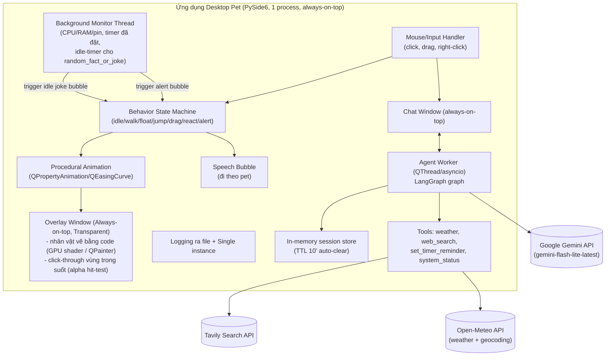

# CONTEXT.md — Lavenzure Desktop Pet

> File này lưu toàn bộ bối cảnh dự án để đọc lại và hiểu nhanh mục đích, kiến trúc, quyết định kỹ thuật. Cập nhật file này mỗi khi có quyết định mới hoặc thay đổi thiết kế quan trọng.

## 1. Mục đích dự án

Xây dựng một **desktop pet cá nhân** tên **Lavenzure**, lấy ý tưởng từ nhân vật **Calcifer** (fan art phong cách Ghibli, không dùng asset gốc phim) chạy nền trên Windows:

- Sống ở **lớp desktop background** (không nổi lên trên các ứng dụng khác đang mở — dùng kỹ thuật gắn cửa sổ vào WorkerW).
- Tự động di chuyển/animate liên tục theo 3 kiểu: đi dọc mép màn hình, bay lơ lửng tự do, nhảy.
- Tương tác chuột: click → animation phản ứng + random 1 câu thoại; kéo-thả để di chuyển nhân vật.
- Right-click → mở cửa sổ chat (nổi lên trên các app khác để luôn gõ được), chat bằng text (voice để sau).
- Là một **agent thực sự** có khả năng gọi tool (weather, web search, ...) để trả lời câu hỏi, không phải chatbot thuần.
- Dùng cá nhân (không phát hành công khai/thương mại) — cần lưu ý bản quyền nhân vật Ghibli.

## 2. Kiến trúc tổng thể

**Một process Python duy nhất** (không tách service riêng qua network), gồm 2 mảng logic:



### Lý do chọn kiến trúc này
- Overlay (PySide6) và Agent (LangGraph) đều là Python → gộp 1 process, giao tiếp qua Qt signal/slot, tránh phải chạy thêm 1 local server/WebSocket (đơn giản hơn, ít rủi ro bảo mật hơn).
- Agent chạy trong thread/asyncio riêng để không block UI thread khi chờ LLM/tool trả lời.

## 3. Quyết định kỹ thuật đã chốt

| Hạng mục | Quyết định |
|---|---|
| Ngôn ngữ / GUI framework | Python + **PySide6** |
| Hệ điều hành mục tiêu | Windows only, **1 màn hình** (không cần hỗ trợ multi-monitor) |
| Kiểu cửa sổ overlay | **Always-on-top + transparent background thông thường** (Qt.WindowStaysOnTopHint + WA_TranslucentBackground). KHÔNG dùng kỹ thuật WorkerW/gắn desktop layer nữa — pet luôn nổi trên mọi ứng dụng khác |
| Click-through | Vùng trong suốt xung quanh nhân vật phải cho chuột xuyên qua app phía dưới (alpha-based hit-test / QRegion mask), chỉ vùng có pixel thật của nhân vật mới bắt sự kiện chuột |
| LLM provider | **Google Gemini API trực tiếp** (không qua OpenRouter nữa), model **`gemini-flash-lite-latest`** (từ 2026-11-13; bí danh luôn trỏ bản Flash-Lite mới nhất, không "suy nghĩ", nhanh gấp 2-3 lần `gemini-flash-latest`; gọi qua endpoint `v1beta`; `gemini-2.0-flash` cũ đã bị Google ngừng), câu trả lời được stream (chữ hiện dần), dùng `langchain-google-genai` (`ChatGoogleGenerativeAI`), key trong `GEMINI_API_KEY`. Client tạo lúc chat lần đầu (thiếu key app vẫn chạy); lỗi (sai key, hết quota, mất mạng, model bị ngừng…) hiện thành câu báo lỗi tiếng Anh dễ hiểu, chi tiết ghi vào log |
| Agent framework | **LangGraph** (không dùng Google ADK cho project này) |
| System Tray | Icon tray luôn hiện khi app chạy, cho phép **bật/tắt hiển thị pet** (ẩn overlay nhưng agent/monitor vẫn chạy nền), menu chuột phải gồm 3 mục: `Hide/Show Pet`, `Settings` (cửa sổ chỉnh cấu hình nhỏ), `Quit App`. Cửa sổ Settings (2026-11-13) cho chọn **30 / 60 fps** cho mọi hoạt ảnh (mặc định 30, user chốt), có hiệu lực ngay, kèm số fps đang vẽ; lựa chọn nhớ trong `%LOCALAPPDATA%\Lavenzure\settings.json`, mặc định ở `config.yaml` `character.fps`. **Lửa nhẹ** (lửa vẽ ở độ phân giải thấp hơn) user đã chốt nên luôn bật, không có ô trong Settings; tắt bằng `performance.lite_flame` trong `config.yaml` |
| Kiến trúc process | 1 process duy nhất, agent chạy trong thread/asyncio riêng trong app PySide6. **Chỉ cho chạy 1 bản** (`QLockFile` + `QLocalServer`): mở app lần 2 sẽ mở cửa sổ chat của bản đang chạy |
| Logging | Ghi log xoay vòng (1 MB × 3) ở `%LOCALAPPDATA%\Lavenzure\logs\lavenzure.log`, gồm cả lỗi không bắt được (vì `pythonw.exe` không có console) |
| Kiểm thử / lint | `pytest` (chạy không cần màn hình, giả lập mạng và psutil) + `ruff`; cấu hình trong `pyproject.toml`, công cụ trong `requirements-dev.txt` |
| Animation | **Nhân vật vẽ hoàn toàn bằng code**, không cần file PNG. Kích thước `character.scale` = **0.75**; mặc định 30fps (`character.fps`, user chốt 2026-11-13; Settings cho chọn thêm 60). Phong cách sticker phẳng theo ảnh mẫu fan-art user gửi: lớp đỏ / cam / vàng, một đường viền nâu đỏ đậm liền mạch, mắt trắng viền đậm, miệng đỏ có lưỡi hồng. **Giữ quầng sáng (glow)**, **không thêm viền trắng kiểu sticker** (xem §7). Code chia 3 phần (2026-11-12, cập nhật 3): (1) `character.py` lo vật lý thân (nghiêng/giãn/nảy/nhún theo chuyển động cửa sổ), glow và tàn lửa. (2) `face.py` lo khuôn mặt: mắt + miệng nằm gọn trong "vùng an toàn" hình elip trên phần thân vàng; biểu cảm chuyển bằng lò xo có lấy đà; miệng đổi trễ hơn mắt ~75ms; có mí trên/dưới; mặt xoay theo khối cầu khi nhìn theo chuột và trễ nhẹ khi thân di chuyển; thỉnh thoảng có biểu cảm nhỏ ngẫu nhiên lúc rảnh. (3) **Thân lửa có 3 bộ vẽ**, chọn bằng `character.flame_renderer` trong `config.yaml` (**mặc định: `shader`**, user chốt 2026-11-12): `metaball` (mô phỏng lưỡi lửa + metaball, `fire_field.py`); `shader` (GPU shader GLSL vẽ offscreen bằng QOpenGL, `flame_shader.py`: nhiễu 3D bị bẻ cong + nhiễu gợn nhọn tạo các lưỡi lửa, ~3-4ms/frame); `baked` (`flame_baked.py`: phát lại mô phỏng chất lỏng thật do `src/bake_flame.py` tính trước và lưu ở `assets/flame/baked_flame.npz`; chọn đoạn ngẫu nhiên và chuyển mượt giữa các đoạn nên không thấy lặp; ~6-7ms/frame). Nếu `shader`/`baked` không chạy được (máy không có OpenGL 3.3, thiếu file clip) thì tự quay về `metaball`. Cả 3 dùng chung hình thân (`flame_common.py`) và **"thời tiết lửa"** (lúc êm / gió giật / lách tách / dịu xuống) để lửa không đều đều dễ đoán. Vị trí cửa sổ lưu dạng số thực (sub-pixel), dùng chung đồng hồ animation của Qt nên không giật. Click-through dựa vào alpha từng pixel của Windows (không dùng `setMask`). Cách PNG cutout cũ trong [ANIMATION_TUTORIAL.md](./ANIMATION_TUTORIAL.md) không còn dùng |
| Kiểu di chuyển | Cả 3: đi dọc mép màn hình, bay lơ lửng tự do, nhảy — random luân phiên |
| Tương tác click | Chuột trái: chọn ngẫu nhiên 1 phản ứng trong bộ gồm mọi hoạt ảnh của pet + "nói 1 câu ngẫu nhiên". Chuột phải: menu `Chat` / `Idle` (đang Idle thì thành `Wander`) / `Hide Pet` (thêm 2026-11-14); Idle có tư thế nằm nghỉ/ngủ riêng (chốt 2026-11-12, chưa làm — hiện code vẫn là mặt vui + câu thoại, chuột phải mở thẳng chat) |
| Kéo thả | Cho phép kéo-thả di chuyển nhân vật |
| Chat window | Mở bằng right-click, always-on-top, text-only (v1), voice để sau. Mở cạnh pet, tông màu lửa, Esc để đóng; chữ người dùng được escape, câu trả lời hiển thị Markdown; câu trả lời ngắn (≤ `chat.reply_bubble_max_chars`) hiện cả trong bong bóng trên đầu pet. Bong bóng thoại luôn đi theo pet |
| Lịch sử hội thoại | Không lưu lâu dài — chỉ lưu trong RAM, tự xóa sạch sau **15 phút** không chat (TTL; chốt 2026-11-12, code hiện vẫn 10 phút cho tới khi làm), không có cách lấy lại |
| Tool: weather | **Open-Meteo** (free, không cần API key). Vị trí lấy từ prompt người dùng (LLM trích xuất tên địa điểm → geocode qua Open-Meteo Geocoding API → lấy thời tiết) |
| Tool: web_search | **Tavily** (free tier, cần API key) |
| Tool: set_timer_reminder | Đặt hẹn giờ theo yêu cầu chat (tối đa 24 giờ, chỉ lưu trong RAM), hết giờ → pet nhảy lên + hiện bong bóng nhắc nhở; đang có cảnh báo thì nhắc nhở hiện chung bong bóng với cảnh báo; pet đang ẩn thì hiện thông báo ở khay hệ thống |
| Tool: system_status | Theo dõi CPU/RAM/pin định kỳ (background thread); ngưỡng cảnh báo đã chốt: **pin < 30%**, **CPU > 90%**, **RAM > 90%** → tự động trigger animation cảnh báo + bong bóng thông báo, **giữ nguyên cho tới khi người dùng click vào pet** (hoặc chọn `Idle`) mới tắt; tắt xong pet **im 10 phút** rồi mới báo lại nếu vẫn quá ngưỡng (`system_status.snooze_minutes`, user chốt 2026-11-14). Cũng có thể được LLM gọi chủ động khi người dùng hỏi (vd "pin còn bao nhiêu") |
| Tool: random_fact_or_joke | Không phải tool do LLM gọi — là hành vi chủ động (ambient): sau một khoảng thời gian idle (không chat), tự động hiện bong bóng với 1 câu random từ list 50 câu (đã soạn sẵn trong `data/facts_jokes.json`) |
| Ngôn ngữ câu thoại tự động | Tất cả các câu hiển thị tự động trên màn hình (fact/joke, phản ứng khi click) đều bằng **tiếng Anh** |
| Autostart | Giai đoạn dev: shortcut trong thư mục Startup Windows chạy bằng `pythonw.exe`; giai đoạn sau: Task Scheduler khi đóng gói .exe |
| Bản quyền | Dùng fan art tự tạo/stylized, không dùng asset gốc phim; chỉ dùng cá nhân |

## 4. Quyết định còn mở

Hiện không còn câu hỏi mở. Các câu hỏi cũ (Gemini trực tiếp, chu kỳ `system_status` 45 giây, idle 15 phút trước khi nói fact/joke) đã chốt; asset PNG không còn cần vì nhân vật vẽ bằng code.

## 5. Cấu trúc thư mục

```
pet/
├── README.md / README_vi.md  # giới thiệu + cài đặt (tiếng Anh / tiếng Việt)
├── CLAUDE.md                 # hướng dẫn cho AI coding agent
├── docs/                     # mọi tài liệu .md ngoài README
│   ├── CONTEXT.md
│   ├── implementation_plan.md
│   ├── DECISION_LOG.md          # nhật ký quyết định đã chốt + việc còn bàn
│   └── ANIMATION_TUTORIAL.md    # hướng PNG cutout cũ (đã bỏ, chỉ để tham khảo)
├── requirements.txt
├── requirements-dev.txt         # pytest, ruff
├── pyproject.toml               # cấu hình pytest + ruff
├── .env.example              # GEMINI_API_KEY, TAVILY_API_KEY
├── config.yaml                # idle_timeout_minutes, model_name, system_status thresholds, joke_interval...
├── assets/
│   └── flame/                  # baked_flame.npz: clip mô phỏng lửa cho bộ vẽ `baked`
├── data/
│   ├── click_reactions.json     # list câu thoại khi click
│   └── facts_jokes.json           # list ~50 câu random_fact_or_joke
├── src/
│   ├── main.py                  # entry point, khởi tạo QApplication, nối các thành phần bằng signal
│   ├── config.py                # đọc config.yaml + .env
│   ├── app_logging.py           # log xoay vòng ra file (%LOCALAPPDATA%\Lavenzure\logs)
│   ├── single_instance.py       # chỉ cho chạy 1 bản (QLockFile + QLocalServer)
│   ├── character_preview.py     # xem/so sánh nhân vật và 3 bộ vẽ lửa
│   ├── bake_flame.py            # chạy offline: mô phỏng lửa → assets/flame/baked_flame.npz
│   ├── overlay/
│   │   ├── overlay_window.py      # always-on-top, transparent, click-through window
│   │   ├── behavior.py            # state machine idle/walk/float/jump/drag/react/alert
│   │   ├── character.py           # nhân vật vẽ bằng code (vật lý thân, glow, tàn lửa)
│   │   ├── face.py                # khuôn mặt + biểu cảm (mắt, mí, miệng, lò xo)
│   │   ├── face_refs.py           # mắt / miệng dò từ ảnh mẫu (vui hình 1, chill hình 7)
│   │   ├── flame_common.py        # hình thân chung, "thời tiết lửa", interface bộ vẽ lửa
│   │   ├── fire_field.py          # bộ vẽ lửa `metaball` (lưỡi lửa + metaball)
│   │   ├── flame_shader.py        # bộ vẽ lửa `shader` (GPU GLSL, QOpenGL offscreen)
│   │   ├── flame_baked.py         # bộ vẽ lửa `baked` (phát lại mô phỏng chất lỏng)
│   │   └── animation.py           # QPropertyAnimation helpers (di chuyển cửa sổ, sub-pixel)
│   ├── chat/
│   │   └── chat_window.py          # cửa sổ chat text (always-on-top)
│   ├── agent/
│   │   ├── graph.py                  # LangGraph graph definition (tạo client lúc dùng lần đầu)
│   │   ├── errors.py                 # phân loại lỗi → câu báo lỗi thân thiện
│   │   ├── memory.py                 # in-memory TTL (10') session store
│   │   └── tools/
│   │       ├── weather.py             # Open-Meteo (geocode theo prompt + forecast)
│   │       ├── web_search.py           # Tavily
│   │       ├── set_timer_reminder.py
│   │       └── system_status.py         # query on-demand qua chat
│   ├── monitor/
│   │   └── background_monitor.py    # thread nền: CPU/RAM/pin polling, idle-timer cho joke, timer reminders
│   └── autostart/
│       └── install_startup.py     # tạo shortcut Startup folder
tests/                          # pytest (chạy headless)
```

## 6. Rủi ro / ghi chú kỹ thuật cần nhớ

- Overlay always-on-top + transparent phải làm click-through đúng: nếu không mask theo alpha, cả bounding box (kể cả phần trong suốt) sẽ chặn chuột tới app phía dưới → gây khó chịu khi làm việc.
- Không phải model OpenRouter nào cũng hỗ trợ tool-calling ổn định — cần chọn model có function-calling support rõ ràng.
- `system_status` chạy trên background thread liên tục — cần polling interval hợp lý (vd 30-60s) để tránh tốn CPU không cần thiết.
- Bong bóng cảnh báo `system_status` phải là **modal-per-pet** (chỉ tắt khi click vào pet), tránh trường hợp nhiều cảnh báo chồng nhau gây rối UI.
- Đây là fan art cá nhân của nhân vật có bản quyền (Ghibli) — không phân phối công khai/thương mại.

## 7. Lịch sử thay đổi thiết kế quan trọng

- 2026-08-13: Chốt kiến trúc ban đầu (overlay tách biệt agent qua WebSocket, đa lựa chọn framework/tech) → sau khi user chọn PySide6 cho cả 2 phía, gộp lại thành 1 process duy nhất, bỏ WebSocket service riêng. Chọn LangGraph thay vì Google ADK.
- 2026-08-13 (cập nhật 2): Bỏ kỹ thuật WorkerW (gắn desktop layer) — đổi sang overlay always-on-top + transparent thông thường (pet luôn nổi trên mọi app). Xác nhận 1 màn hình (bỏ multi-monitor). TTL lịch sử chốt 10 phút. `weather` dùng Open-Meteo với vị trí trích từ prompt người dùng; `web_search` dùng Tavily. Thêm 3 tool/hành vi: `set_timer_reminder`, `system_status` (cảnh báo chủ động, tắt khi click), `random_fact_or_joke` (ambient, tự kích hoạt sau khoảng idle, list ~50 câu). Autostart Startup folder + pythonw.exe xác nhận cho giai đoạn dev. Tạo thêm `ANIMATION_TUTORIAL.md` hướng dẫn cutout/rigging bằng code.
- 2026-08-13 (cập nhật 3): Chuyển LLM từ OpenRouter sang **gọi trực tiếp Google Gemini API** (`gemini-2.0-flash`, qua `langchain-google-genai`) — cần xác nhận lại. Chốt ngưỡng cảnh báo `system_status`: pin < 30%, CPU/RAM > 90%. Thêm **System Tray icon** để bật/tắt hiển thị pet. Tất cả câu thoại tự động (fact/joke, phản ứng click) dùng tiếng Anh — đã soạn sẵn 50 câu fact/joke và 20 câu phản ứng click trong `data/`. Đã tạo `config.yaml` và `.env.example` thực tế trong repo.
- 2026-08-13 (cập nhật 4): Xác nhận chốt Gemini API trực tiếp; `system_status` poll 45s; `random_fact_or_joke` idle cố định 15 phút; sinh thêm 50 câu vào `facts_jokes.json` (tổng 100 câu). **Bắt đầu code thực tế**: tạo `.venv`, cài `requirements.txt`, viết đầy đủ `src/` (overlay always-on-top + click-through mask + placeholder sprite, behavior state machine, speech bubble, chat window, LangGraph agent với Gemini 2.0 Flash + 4 tools, TTL session memory, background monitor cho system_status/reminder/idle-joke, autostart script) và `src/main.py` nối toàn bộ lại. Đã smoke-test build + chạy thành công (Qt offscreen mode). Còn thiếu: `.env` thật (key), asset PNG thật thay placeholder, chạy thử trên desktop Windows thật, Phase 10-12.
- 2026-11-11: Thay hướng PNG cutout bằng **nhân vật vẽ bằng code** (`overlay/character.py`) — nhân vật linh hồn lửa gốc (original design), không cần asset. Behavior: đi bằng tốc độ cố định (~85px/s), nhảy có lấy đà + quỹ đạo parabol thật, click không còn bị tính nhầm khi kéo-thả, cảnh báo được giữ lại sau khi kéo. Bong bóng thoại căn giữa trên đầu nhân vật. Thêm `src/character_preview.py` để xem/thử nhân vật. Đo trên Windows thật: ~2.6ms/frame vẽ, ~11% một nhân CPU ở 30fps, ~22-26% ở 60fps.
- 2026-11-12: Vẽ lại đồ họa nhân vật theo ảnh mẫu fan-art user gửi (sticker phẳng: viền nâu đỏ đậm, lớp đỏ/cam/vàng, mắt trắng to, miệng đỏ). Sửa lỗi nét "đứt gãy": trước đây thân là khối tròn + các lưỡi lửa tam giác ghép rời nên lộ khấc ở chỗ nối; nay mỗi lớp là 1 đường viền liền. Bản thử đầu (5 lưỡi lửa nhọn cố định vị trí) bị user chê "gượng, gai nhọn cố định" → đổi sang dáng giọt nước + lưỡi lửa nhỏ chạy dọc sườn lên đỉnh (vị trí không cố định) + đỉnh chính rung/bùng lửa ngẫu nhiên; đồng hồ nhiễu chạy theo `flicker` nên đổi mood không làm hình giật. Biểu cảm: bỏ má hồng, `alert` dùng mí mắt xếch (giận/hoảng) thay lông mày. Các animation nâng cao (tay, ôm củi, chảo trứng ốp la...) để giai đoạn sau. Đo offscreen trên Windows venv: ~2.3-4ms/frame. Dự án chuyển sang `D:\workspace\pet` (2026-11-12).
- 2026-11-12 (cập nhật 2): Theo góp ý của user (giữ glow, thu nhỏ còn 0.75, ưu tiên animation đẹp/tự nhiên/mượt): thay mô hình "vòng viền + lưỡi lửa theo khe" bằng **mô phỏng lưỡi lửa + metaball** (`fire_field.py`, thêm `numpy` vào requirements) — lửa tự nhập/tách/đứt mẩu như lửa thật, lớp màu không bao giờ thủng lỗ. Chuyển động cửa sổ sub-pixel + đồng bộ với đồng hồ animation của Qt (hết giật khi đi chậm). Mặt sống động hơn: saccade, chớp mắt bất đối xứng, biểu cảm có lò xo, mắt nhắm lại trước khi thành "^ ^" (không bị bóng mờ chồng), miệng nói theo nhiễu. Bỏ "đốm lửa giọt nước" vẽ riêng (lửa tự đứt mẩu rồi), tàn lửa vẽ sau thân. `character.scale` = 0.75. **Quyết định không thêm viền trắng kiểu sticker**: đó là đường cắt khi in sticker, trên viền lửa thay đổi liên tục nó sẽ nhấp nháy/rung và làm nhân vật trông như hình dán; quầng glow đã đủ tách nhân vật khỏi nền desktop. Đo offscreen trên Windows venv (scale 0.75): ~2.5-5ms/frame.
- 2026-11-12 (cập nhật 3): Làm lại thân lửa và khuôn mặt theo góp ý của user. Góp ý: lửa lặp lại, dễ đoán; chuyển động xấu; biểu cảm cứng; miệng cười tràn ra khỏi mặt; mặt bè ra 2 bên. **Mặt**: tách ra `face.py`; thân tròn hơn, bớt rộng; mọi nét mặt bị giới hạn trong vùng an toàn trên phần thân vàng. Biểu cảm có thời điểm lệch nhau, lò xo vượt đích, lấy đà, mí mắt, quay đầu theo khối cầu, biểu cảm nhỏ lúc rảnh. Miệng vẽ từ đường môi (hình chữ D / mếu / lượn sóng / nhếch). **Lửa**: thêm "thời tiết lửa" chung và 2 bộ vẽ mới để user so sánh với `metaball`: `shader` (GPU) và `baked` (mô phỏng chất lỏng tính trước). User chọn bằng `character.flame_renderer`. **User đã so sánh và chốt `shader` làm mặc định** ("tương đối hài lòng"); `metaball`/`baked` vẫn giữ để dự phòng/so sánh. Đo trên Windows venv (scale 0.75, update+vẽ): metaball ~4ms, shader ~3-4ms, baked ~6.5ms/frame.
- 2026-11-12 (cập nhật 4): Viết `README.md` (tiếng Anh) + `README_vi.md` và kế hoạch tiếp theo. **Sửa chat bị hỏng**: Google đã ngừng `gemini-2.0-flash` (404) → user chốt đổi sang **`gemini-flash-latest`** (endpoint `v1beta`); đọc đúng câu trả lời dạng nhiều khối của model mới. Giai đoạn A: log ra file, báo lỗi rõ ràng (sai key / hết quota / mất mạng / model bị ngừng / thiếu key), không crash khi thiếu key, tool chịu lỗi mạng, chỉ chạy 1 bản. Giai đoạn B: bong bóng đi theo pet, chat escape HTML + hiển thị Markdown + giao diện tông lửa + mở cạnh pet + Esc, câu trả lời ngắn hiện trong bong bóng, hẹn giờ an toàn giữa các thread + kiểm tra đầu vào + pet nhảy khi nhắc. Giai đoạn D: thêm pytest (46 test), ruff, bổ sung docstring, dọn tài liệu. User đồng ý A, B, D; F (đóng gói) để sau; C, E chờ user quyết sau khi được giải thích thêm.
- 2026-11-12 (cập nhật 6): Sửa 7 điểm user góp ý (xem `DECISION_LOG.md` lượt 9): miệng một hình biến đổi liền (hết "ồ" bị mờ/chồng), miệng luôn dưới mắt; vui/hoảng/giận/chill vẽ lại theo ảnh tham khảo (giận bỏ lông mày rời, dùng mí chéo đậm); lửa hoảng tua tủa bốc lên tự nhiên; chảo của `chill` nằm trong lửa (vẽ sau thân lửa); chuyển biểu cảm êm hơn khi ngủ/thức; tay trên khúc củi thành cục tròn.
- 2026-11-12 (cập nhật 7): Sửa 8 điểm user góp ý + hình 8 (xem `DECISION_LOG.md` lượt 10): chill/vui mắt cong vòm theo hình 7/1, chảo đặt trên đầu phía trước lửa; chill không đi cùng khúc củi; lửa hai bên của hoảng/chill luôn bốc lên (hết cục nhọn chĩa ngang); trên củi mặt nhích lên, tay dời ra hai bên; giận miệng há to theo hình 6, tay lửa mềm mượt; vui không nhảy; ngáp nhắm mắt một lần rồi ngủ; thêm biểu cảm `yuck` (hình 8, mắt lệch, thè lưỡi) vào bộ phản ứng click.
- 2026-11-12 (cập nhật 8): Lượt 11 (xem `DECISION_LOG.md`): mắt vui / chill thành hình hạnh nhân theo hình 1 / 7, miệng vui bo tròn, miệng chill một đường cong liền có móc nhỏ hai đầu, miệng cách mắt xa hơn; tay trên khúc gỗ là một phần của ngọn lửa (shader), khúc gỗ vẽ sau lửa; bỏ tay của `angry`.
- 2026-11-12 (cập nhật 9): Lượt 12 (xem `DECISION_LOG.md`): AI chọn được thêm `yuck`; ngủ không nhìn theo chuột; mắt + miệng của vui (hình 1) và chill (hình 7) chép y ảnh mẫu bằng dữ liệu dò từ ảnh (`src/overlay/face_refs.py`); tay trên khúc gỗ theo hình 4 (thân phủ lên gỗ, phần đè lên gỗ toàn vàng).
- 2026-11-12 (cập nhật 5): Làm xong các mục đã chốt trong `DECISION_LOG.md` (lượt 7). **G4** tắt công cụ hẹn giờ. **G3** bong bóng chat gắn với pet thay cửa sổ chat. **G1** chuột trái chơi 1 hoạt ảnh ngẫu nhiên từ bộ phản ứng (mỗi phản ứng tự đăng ký bằng `@reaction`; không lặp lại liền nhau; đang cảnh báo thì chỉ tắt cảnh báo). **G2** chuột phải mở menu `Chat` / `Idle`↔`Wander`; Idle = nằm ngủ, chat/kéo/cảnh báo làm pet tỉnh rồi ngủ lại. **E1** biểu cảm mới theo ảnh user chọn: vui (2 mặt), hoảng (lửa bè vuông, viền tua tủa, miệng há to), giận (lông mày, mắt nheo, hai tay lửa có nắm đấm), bay trên khúc củi (củi hiện ra kèm tia lửa, tan thành tàn lửa khi đáp), `chill` + chảo thịt xông khói/trứng; AI gắn thẻ cảm xúc đầu mỗi câu trả lời, pet giữ mặt đó ~5 giây; AI trả lời theo ngôn ngữ user. **E2** tư thế ngủ (ngáp, lửa lùn bè, thở chậm, chữ "z"), ngủ gật sau 10 phút không đụng chuột/bàn phím (`GetLastInputInfo`), ban đêm 20h–5h lửa dịu và cử động chậm. **C1/C2** icon khay vẽ từ chính nhân vật, menu khay `Hide/Show Pet`, `Settings` (cửa sổ trống), `Quit App`. Thêm `src/ui/`, `overlay/props.py`, `agent/emotion.py`, `monitor/user_activity.py`; 85 test.
- 2026-11-13: Đổi tên pet từ **Calcifer** thành **Lavenzure** ở mọi nơi (README, giao diện, system prompt, tên class `LavenzureApp`, biến môi trường `LAVENZURE_FRAME_STATS_SECONDS`, thư mục/file log, shortcut autostart `Lavenzure.lnk`, tài liệu). Calcifer chỉ còn được nhắc như nguồn cảm hứng ý tưởng trong README và `CONTEXT.md`. Tên file ảnh tham khảo `docs/references/calcipher*.jpg` giữ nguyên.
- 2026-11-13 (cập nhật 2): **Chat nhanh hơn** (user chọn): đổi model sang `gemini-flash-lite-latest` (hiện là gemini-3.5-flash-lite) vì `gemini-flash-latest` (= gemini-3.8-flash, luôn "suy nghĩ" ~200 token) mất 4-8 giây mỗi câu; Lite mất 1,4-3,7 giây. Thêm **streaming**: chữ hiện dần trong bong bóng chat, mặt cảm xúc hiện ngay khi nhận được thẻ cảm xúc. Xem `DECISION_LOG.md` lượt 13.
- 2026-11-13 (cập nhật 3): **Giảm CPU / GPU** (Phase 12, `DECISION_LOG.md` lượt 14). Bớt tính toán thừa mỗi khung mà không đổi hình (~8,5 → ~7,2 ms/khung). Thêm 2 chế độ bật/tắt trong cửa sổ Settings để user thử: tốc độ khung hình tự đổi và lửa nhẹ (đo nhanh: CPU 3,2% → 2,0% / 2,9% / 1,7% khi bật một hoặc cả hai). Chưa làm: tạm dừng khi có app toàn màn hình, lửa 30 fps.
- 2026-11-13 (cập nhật 4): User chốt **lửa nhẹ** (luôn bật, bỏ ô bật/tắt khỏi Settings). Thêm lựa chọn **giới hạn 60 / 45 / 30 fps** cho mọi hoạt ảnh trong Settings để thử (`DECISION_LOG.md` lượt 15).
- 2026-11-13 (cập nhật 5): User chốt **30 fps mặc định** (Settings vẫn cho chọn 45 / 60) và **bỏ chế độ tốc độ khung hình tự đổi** (`DECISION_LOG.md` lượt 16).
- 2026-11-13 (cập nhật 6): User bỏ mức **45 fps**, Settings chỉ còn **30 / 60** (`DECISION_LOG.md` lượt 17).
